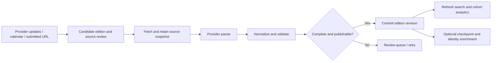

# All-time rankings and race analytics: research and proposed roadmap

Research date: November 9, 2026. Updated after owner review: the overall direction is accepted, with full-field pagination required and delivery web first while supporting native mobile. Detailed analytical policies remain implementation decisions; no production behavior has changed.

## Recommendation

Build a race-results explorer around four questions: **Where do I stand? How have I improved? What happened in my race? What could I aim for next?** Athlete search and useful context for ordinary finishers should lead the first release. A long list of elite times cannot answer those questions.

The first complete experience should be: find a race → find an athlete or enter a time → inspect a result → understand its percentile and nearby finishers → compare another result → save a target. Start with search, result detail, distributions, and trustworthy coverage. Add athlete career pages and historical comparisons next. Split analysis and replay can become the distinctive experience once the data supports them.

Develop the data pipeline alongside these releases. More charts on an incomplete or inconsistently scoped field will create misleading analytics.

## Research scope and evidence

Inspected the current web rankings pages, native benchmarks screen, shared pace calculations, rankings schema, import scripts, parser types, ingestion documentation, and existing Progress/Compete design guidance. External research used first-party product pages, help articles, and API documentation. Competitor observations below are documented capabilities, not a hands-on usability study; engagement benefits are hypotheses to test.

The owner's specific Marathon Replay New York 2026 URL was subsequently retrieved successfully through direct HTTP, along with its analysis, directory, course pages and linked public JavaScript. Findings in section 2a distinguish page markup from rendering code. Local browser access remains disabled: rendered layout, interaction behavior, load times and live data calculations were not verified. Mobbin search returned a paid-plan restriction; no Mobbin screens were used.

No hosted database was queried. Import counts below describe the checked-in October 13 report, not verified production coverage. No application code, schema, imports, production state, or existing living standards were changed for this research.

## 1. Where the product is today

| Area | Evidence | Implication |
| --- | --- | --- |
| Web rankings | `apps/web/src/app/app/rankings/page.tsx` and `[distance]/page.tsx`: distance chooser, separate women/men tables, fastest 200 rows per category | No athlete search, full-field navigation, result detail, date filtering, percentile, or event exploration |
| Read behavior | `loadBoard` returns an empty array on RPC errors; home ignores the stats query error | An outage can look like an empty dataset; distinguish unavailable from genuinely no results |
| Public ledger | Separate `rankings-db` project; sources, snapshots, runs, editions, source records, performances | Useful foundation already exists; extend it additively rather than create another result store |
| Source identity | Source IDs/fingerprints exclude finish time | Corrections can update observations without making a duplicate time record; this is not cross-event athlete identity |
| Coverage | October report contains 195,296 imported rows across six inputs; four 2025 marathons, Berlin 5K, and a 44-result 10K fixture | Large row count, narrow event/year breadth; no documented half-marathon field. Report says SQL files were emitted, not loaded to hosted DB |
| Partial field | Chicago report has 54,109 rows versus 54,315 listed publicly, an unresolved difference of 206 | Reconcile source populations, exclusions, and missing categories before claiming complete coverage |
| Native benchmarks | `apps/mobile/app/benchmarks.tsx` calls `paceBoard`, then links out to published rankings | Two distinct products currently sit near each other: generated training comparisons and sourced race results |
| Benchmark semantics | `packages/shared/src/compete/pace.ts` scales a longer activity's moving time down proportionally; opponent times derive from Elo | These values cannot become official race results, personal records, or empirical population percentiles |
| Personal records | Design guide and feature review specify qualifying whole-session records, dated improvement staircase, and no invented splits | Reuse the interaction and visual grammar, but reconcile the benchmark discrepancy before integrating data |
| Ingestion | OpenTrack, MikaTiming, CSV, RunSignup; hard-coded catalog and CLI execution | Good parser groundwork, not yet an unattended discovery/publication service |
| Enrichment | Current normalized finish type has clocks, name, category, age, source; no checkpoints or linked athlete | Replay, careers, local-athlete rankings, and pacing analytics need new data capabilities |

Relevant local evidence: [ingestion](ingestion.md), [data status](data-status.md), [trial report](ingestion-trial.json), [design guide](design-guide.md), [activity detail](reviews/activity-detail/README.md), [feature stack](reviews/feature-stack-2026-10-21.md).

## 2. What comparable products teach us

| Product/reference | Verified pattern | Application to Overtaek |
| --- | --- | --- |
| [RunRepeat percentile calculator](https://runrepeat.com/how-do-you-masure-up-the-runners-percentile-calculator) | Enter a finish time and compare it with a large results corpus, including age/sex comparisons | Give every finisher immediate context. Always name our actual dataset and denominator rather than imply worldwide coverage |
| [Strava leaderboard filters](https://support.strava.com/en-us/articles/15401771-how-do-i-filter-segment-leaderboards-on-strava) | Time windows, demographic categories, own results, following and club comparisons | Make the relevant field easy to select; remember filters and provide an around-me view. Road results need their own eligibility rules |
| [World Athletics top lists](https://worldathletics.org/records/all-time-toplists/road-running/10-kilometres/outdoor/men/senior?bestResultsOnly=true) | Explicit best-by-athlete versus all-results selection | Separate ranking performances from ranking people. A repeat racer must not silently occupy many slots in an athlete board |
| [Athlinks result claiming](https://athlinks.zendesk.com/hc/en-us/articles/115000660764-How-do-I-find-and-claim-results-in-Athlinks) | Search by name, narrow candidates, claim a result, hide incorrect matches; discrepancies can require review | Build identity correction and undo into claiming. Search results can ship before global automatic identity resolution |
| [Athlinks automatic matching](https://athlinks.zendesk.com/hc/en-us/articles/360018974993-There-are-results-on-my-profile-that-I-didn-t-claim-Has-my-account-been-compromised) | Matching uses several attributes; incorrect matches still occur | A matching score is not proof. Avoid merging every identical name into one athlete |
| [RUNALYZE feature overview](https://runalyze.com/help/article/features?_locale=en) | Trends, distribution comparisons, race results and flexible activity search | Connect results into a dated story; expose the comparison and the underlying observations |
| [RUNALYZE performance curves](https://blog.runalyze.com/features/performance-curves-for-single-activities/) | Curves describe achieved performance over contiguous activity intervals | Keep recorded achievements separate from equivalent-time estimates; a scaled workout is not an observed best split |
| [Pace Notes race replay](https://splithappens.run/stories/race-replay) | Recorded checkpoint data becomes a story about the field spreading out | Make the interesting question visible before presenting controls or animations |
| [Pace Notes methodology](https://splithappens.run/methodology) | Separates finishes from people, incomplete checkpoint data, observational findings, modeled context and source limitations | Put cohort, coverage, clock basis and missing-data rules into the analytics contract |

The opportunity is to combine accessible result discovery, personal progression, and an engaging explanation of race execution. This research establishes useful patterns; it does not establish competitor market share, conversion, or retention.

## 2a. Marathon Replay: New York 2026 follow-up

The [replay page](https://www.marathonreplay.com/newyork/2026) exposes four clear destinations: replay, course information, runner analysis and runner directory. Its controls include favorites, selectable view modes, playback speed, wave/runner timeline jumps and camera following. Sharing lets users choose whether selection, favorites, time and camera belong in the link. These controls are present in the fetched HTML; their runtime operation was not tested.

The [runner-analysis page](https://www.marathonreplay.com/newyork/2026/stats) starts with name/bib search, favorites and a random-finisher entry. Its linked rendering script defines finish distributions, checkpoint placement, pacing versus similar finishers, half splits, passing, goal margins, projected finishes, fade/consistency/finishing strength, nearby finishers and comparisons with a favorite. It distinguishes elapsed-time gaps from physical road order when runners started at different times. These are code-supported capabilities, not verified outputs for a selected athlete.

The [directory](https://www.marathonreplay.com/newyork/2026/runners) makes the whole field interesting through category leaders, country summaries, hometowns, clubs and stories about non-winning finishers. This offers an exploration path for visitors who do not arrive with a specific athlete in mind. Its HTML also contains loading and race-day placeholder text, so it does not establish that every section has populated data.

The [course page](https://www.marathonreplay.com/newyork/2026/race-day) accepts a runner or finish/start scenario and describes contextual analysis of terrain and conditions. This is a useful later research direction. Any modeled time adjustment in our product would need explicit assumptions and validation; environmental context should ship before an authoritative-looking adjusted result.

### What this changes in our priorities

Promote **around-selected-finisher navigation**, **favorites**, and a direct **compare** action into the early design. They connect existing results into a browsing journey without needing automatic career identity. A saved result is just a saved observation; it does not assert that the user is that runner.

Add a second event entry path alongside search: **Explore the field**. Begin with supported category leaders, distribution bands and finish-time milestones. Country, hometown and club stories should appear only after those source fields are retained and checked. Avoid creating geographic or club relationships from name matching.

Keep advanced analysis in focused destinations rather than stack every available metric on the first screen. Start with result context, then comparisons, then pacing/replay when supported. Preserve result and comparison selection when navigating between them. Favorites can persist locally first; cross-device saving needs authenticated persistence and a separate implementation pass.

The strongest lesson is that a result can connect to several other interesting results. Our broad all-time explorer can add a cross-event and historical layer to that pattern. Its success still depends on complete fields and trustworthy identity, not the number of analytics panels.

## 3. The baseline release: complete the 0→1 experience

### Search and full-field rankings

Search athletes and events from the rankings entry. Inside an edition, allow name and bib search. Initially return result candidates with event, year, category and time; do not invent a unified career when identity is unresolved. Handle accents, spaces, alternate spellings and ambiguous names without erasing the source spelling.

Offer distance, source category, event/edition, year and time-range filters. Expand to last 12 months, all covered years, and custom dates once coverage spans those windows. Show age-at-event filters only where supplied. Event location is not athlete residence; defer athlete-local rankings until trustworthy residence data exists.

Full-field pagination is an owner-confirmed requirement: every published eligible result must be reachable, with no fastest-200 ceiling. Page size is a transport/display choice, not a dataset limit. Provide jump to a time and around-selected-result navigation. Searching a name must not recalculate that person's rank against only matching names. Persist filters, sort, selected result and scroll position in navigation; make the view shareable by URL. Native rows should prioritize rank, athlete and time, with race metadata in the detail view rather than a wide mandatory table.

Use bounded server-side pages with a deterministic sort and tie breaker. Compute ranks and aggregates against the complete eligible cohort before paging. Bind paging to the filter/sort state and an edition/data revision so a refresh cannot silently skip or duplicate rows. Changing filters resets page position; Back restores the prior page. Search and around-result lookup must work beyond any previously loaded page. Numbered desktop pages and native Next/Previous or progressive loading can use the same page contract; expose loaded ranges and total counts accessibly on both.

Default the first version to **Results**, since that is what the data supports. Introduce **Athletes · best result** only after identity linking has sufficient coverage and precision. Include source-supported categories beyond women and men; unknown category must not be silently recoded.

### Result detail

Every result needs a permanent destination with finish time, pace/km or mile, edition/date, source category, and source link. Show source-official placement if available and distinguish it from a placement computed within our eligible records. Chip-time sorting is not necessarily the organizer's official order.

The primary analytic is a finish-time distribution with a selected-result marker. Beneath it: selected cohort rank, count, faster-than percentage, and a short list of neighboring finishers. Allow changing category or age cohort without losing the selected athlete. Keep the source and coverage summary inspectable.

Offer a temporary **Compare another time** interaction, such as “Where would 3:30 place in this field?” The entered value is a hypothetical marker and cannot create a stored result or award.

### Useful event analytics

Each event edition should have results and analysis in one place: distribution, median, percentile thresholds, selected sub-time shares, category breakdown, eligible count and available historical editions. Clicking a histogram bin filters the results; a percentile threshold links to the corresponding section of the board.

An incomplete import can remain searchable with its coverage disclosed, but suppress field-wide percentile claims until the completeness check passes. Event analytics should include all qualifying finishers, not the fastest 200.

## 4. Make the next layer meaningfully engaging

| Feature | The athlete's question | Why return? | Data dependency / priority |
| --- | --- | --- | --- |
| Career page | How have I improved? | A new race extends a personal story | Confirmed result links; next release |
| PR staircase + race dots | When did my best change, and how were the races between? | Progress remains visible between big milestones | Same-distance comparable clocks; next release |
| Goal percentile | What time would move me into the next band? | A personally chosen target with a concrete gap | Complete cohort; baseline interaction, saved targets later |
| Best this year / recent best | What can I do now versus my lifetime best? | A fresh start without erasing history | Multi-year results; next release |
| Compare 2–4 races | Which performance was strongest? | A new result invites comparison | Identity for personal races; source distinctions always visible |
| Saved cohort | How am I doing among the field I care about? | A meaningful board rather than one elite list | Saved filters; next release |
| Race execution | Where did I gain or lose ground? | Post-race analysis and next-race preparation | Real checkpoint coverage; later |
| Nearby pack replay | What happened to the runners around me? | Emotional replay and shareable moments | Checkpoints, valid clock alignment; later |
| Edition comparisons | Was this year's field different? | Event research before entry or after race day | Several complete editions; later |
| Crew race collection | How did our crew do? | Existing relationships make results matter | Member-confirmed links and privacy controls; later |
| Qualifying-time explorer | What standards do I meet? | Useful planning around upcoming events | Versioned official standards/windows; later |
| Event passport | Which races and distances have I completed? | Collection and achievement beyond speed | Confirmed official finishes; later |

The strongest proposed return loop is **result arrives → result receipt → new personal comparison → chosen next target**. For people racing only a few times a year, use existing Progress training history between races; don’t manufacture a daily reason to check a static all-time board.

Useful sharing: a result card showing a PR or cohort result with a link back to its evidence; a two-race improvement card; a short replay clip when supported. Keep sharing user initiated. Saved-result updates can appear in-app first; email/push would require a separate opt-in product decision.

Avoid rewarding raw workout volume to climb road-race rankings. Avoid unexplained rank-loss alerts, forced streaks and overtraining incentives. Add completion, consistency and distance milestones so engagement is not restricted to fast athletes. Any new badges or social features remain proposals, not changes to current product policy.

## 5. Analytical rules that need to be explicit

**Percentiles.** For a valid cohort of N published eligible performances and time t, proposed “faster than” = `100 × count(time > t) / N`. Equals are ties, not wins. Proposed competition rank = `1 + count(time < t)`; tie order may use IDs for stable pagination but must not imply a different place. Display the cohort and count beside the number. Call this a percentage of recorded finishes unless unique athletes are actually resolved. It is not a percentage of the general population. Hypothetical-time comparisons should say “X% of these finishes were slower” and use the same threshold rule.

**Denominators.** Apply the same source display gate, status, distance, clock, date and category rules to counts, rows and charts. The current adult filtering means these are adult-eligible stored results, not every entrant. Unknown ages remain unknown and cannot enter an age-defined cohort. A tiny cohort should show counts rather than a prestigious-looking percentile; a minimum such as 100 is a proposed launch policy to validate, not an existing rule.

**Time and clocks.** Retain chip and gun clocks independently. The first release can retain chip-when-present sorting but must disclose fallback rows; an explicit clock filter is preferable for precise comparisons. Road event dates follow the source's local date. Rolling/date windows must have documented inclusive/exclusive boundaries; do not impose the weekly competition calendar on independent race editions.

**Change over time.** Distinguish finish-time improvement, rank movement and percentile movement. They answer different questions. A faster race may have a worse percentile in a stronger field. Backfilling an old race changes data coverage, not an athlete's historical performance. Record both event date and import/correction time. Only claim “ranked X at that time” if a historical ranking snapshot exists; a recomputed current-history series must disclose that basis.

**Comparable fields.** Across editions, display field size, category mix, coverage and event conditions where recorded. Faster median finish times do not establish an easier course. Weather correlations do not establish causation. Age grading is a reference-standard score, not an empirical percentile; defer it until the chosen standard/version and category coverage are defined.

**Replay.** Checkpoint positions are observed; motion between mats is interpolated. A pass between mats is inferred, not precisely timed. Chip-elapsed comparison aligns runners by their own starts; wall-clock replay requires actual start/wave timestamps. Do not mix those views. Missing splits create gaps; finish-only records cannot support a real pacing story. Replay eligibility can be narrower than finish-distribution eligibility, with its own count.

## 6. The event discovery and enrichment engine

Use a provider-first pipeline with a small, reviewed event catalog. Retain the current ledger and importers. An open-ended crawler is a poor first investment compared with dependable supported providers.

### Discovery and scheduling

RunSignup is a promising next connector to validate. Its [updated public result-set endpoint](https://runsignup.com/API/v2/results/updated-result-sets.json/GET) documents timestamp ranges and pagination. This could supply new/changed candidates without scraping arbitrary race websites. Documentation is evidence of a capability, not confirmation of our access, rate allowance, coverage, or redistribution permission.

Its [results endpoint](https://runsignup.com/API/race/:race_id/results/get-results/GET) also documents modified-after fetching and optional split precision. Explicitly enumerate result sets, then page each set. The [API change log](https://runscore.runsignup.com/API/ChangeLog) announces that result-set IDs will be required for multi-set events on or after December 7, 2026. Our URL builder currently omits that ID; account for this before expanding the connector.

Maintain edition dates, expected publication time, provider identifiers, URL, source category support, known counts and review state. Proposed refresh schedule: initial fetch after expected publication; daily checks while provisional; less frequent checks once stable. Use provider limits, backoff and bounded retries. Failed pages should resume safely; a source returning 403 should enter review rather than trigger access-control bypasses.

### Normalize and enrich in layers

1. **Discovery metadata:** canonical event family, edition, distance, date, location, official URL and provider IDs.
2. **Core results:** source result ID, source spelling, bib, clock fields, source placement, recorded category, age or age band, finish status.
3. **Checkpoints:** distance, cumulative time, clock basis, missing/invalid flags and source precision. Compute section pace only from valid consecutive readings.
4. **Identity:** provider athlete ID where available, aliases, candidate links, evidence and reversible confirmed links. Keep account claims separate from public athlete identity.
5. **Context:** edition-specific route/elevation and historical weather with provenance. A current route is not proof of an old route; city weather is not measured conditions for each runner.

An AI-assisted URL classifier or parser-draft tool could reduce onboarding work. It should propose mappings for review; deterministic parsers and fixtures should produce the published clocks, dates and categories. Do not infer missing ages or finish times from names or surrounding rows.

### Publication and observability

Extend existing run/snapshot structures only where needed: durable per-page progress, raw source retention, parser version, expected/parsed/eligible/excluded counts, last successful check, source changes and review reason. Keep failed-run evidence outside a transaction that rolls back the import itself. Publish an edition revision atomically, then refresh dependent caches; preserve the prior version while a refresh is incomplete.

Quality checks should cover repeated pages, missing categories, raw page counts versus accepted adult rows, duplicate IDs, unexpected field-size changes, impossible/nonmonotone splits, mismatched distance, clock consistency and correction handling. A removed source row is not automatically a DQ: only reconcile disappearance after a complete refresh and a defined review rule.

Keep source display approval and organizer opt-out separate from ingestion success. The present SQL emitter updates `display_allowed` from every import; a repeat import with `true` can overwrite a prior opt-out. Fix that before unattended publication. Existing reuse notes describe a working practice, not a license; scale through explicit source-specific review and agreements where needed, without inventing a new blanket approval rule.

### Specific importer issues found by inspection

| Finding | Consequence | Proposed fix |
| --- | --- | --- |
| RunSignup loop stops when accepted `results.length < PAGE_SIZE` | A full page containing excluded youth/unparsed rows can terminate pagination early | Continue according to raw provider pagination/metadata per result set |
| RunSignup does not select a result-set ID | Ambiguous combined paging and upcoming compatibility risk | Discover sets and fetch each explicitly |
| MikaTiming stops repeated pages/overlapping category fetches | Prevents loops but can leave an apparently successful partial field | Store termination reasons and require completeness reconciliation |
| MikaTiming/RunSignup snapshots are based on normalized results | Cannot fully reproduce source-page parsing from that snapshot alone | Retain raw fetched payloads and parser version |
| Import SQL creates run metadata in its import transaction | A rollback can remove the attempted-run record | Persist worker/job outcome independently |
| Reimport writes `display_allowed` again | A previous suppression may be undone | Treat display decisions as separately owned state |

These are static findings, not reproduced failures against live providers. Add regression fixtures before implementing the semantic fixes.

## 7. Fit this into the existing app

**Owner-confirmed delivery order: web first, with native mobile as a supported destination.** Web first means the first complete workflow is delivered there; the read contract, metric rules and navigation model must support both from the outset. Responsive web alone is not the final native deliverable.

| Concern | Desktop web | Narrow web / native mobile |
| --- | --- | --- |
| Results | Dense table, visible filters, explicit pagination | Compact rows, filter sheet, bounded pages or accessible progressive loading |
| Result inspection | Primary result plus adjacent chart/detail where space allows | Dedicated detail screen with one primary reading and inspectable chart |
| Comparison | Side-by-side results and linked chart selection | Selected pair with aligned rows or metric sections; avoid miniature desktop columns |
| Replay | Large scene with timeline and selected-athlete panel | Focused scene, large playback controls, detail sheet; defer secondary controls |
| Navigation | Shareable URLs containing filters and result IDs | Matching route params/deep links, retained list position, predictable Back |

Share portable result/filter/aggregate types and metric calculations; keep provider parsing in `packages/rankings`. Fetch data through a bounded server read contract usable by web and native. Reuse platform UI components and chart conventions, rather than putting DOM dependencies in `packages/shared`. Search, counts and metric eligibility must not diverge by platform. Keep a native review checkpoint during each web feature's design, then deliver the native results/detail workflow before treating cross-platform scope as complete. Any DOM-heavy replay embedding is a later explicit architecture choice; ordinary results and analysis should fit native screens directly.

Use **Progress** for personal race history and the PR staircase, **Compete** for a secondary race-ranking entry, and public web pages for searchable events/results. Keep the existing main navigation. Desktop can expose a dense table plus analysis; mobile should make the selected result and one meaningful comparison prominent, with advanced filters in a sheet.

Reuse existing inspectable charts, dated comparison selection, result receipts, athlete detail navigation and share controls. The training atlas offers a good temporal navigation pattern; the field's selected-athlete context offers a good detail pattern. Reuse behavior and tokens rather than copy every container.

Keep training records, modeled benchmarks and official race results distinguishable in the data contract. A linked race can appear in a personal history without entering weekly volume or Elo automatically. Follow existing yellow/Slate appearance roles, accessible chart selection, large-text support and reduced-motion behavior. Do not add provenance badges identifying fixtures in product UI; use actual source/clock/method context and keep debug isolation in the data layer.

## 8. Suggested sequence of small PRs

| Order | Deliverable | Completion criterion |
| --- | --- | --- |
| 1 | Coverage audit + ingestion correctness | Verify actual hosted counts read-only, reconcile Chicago, fix pagination/approval persistence, preserve run failures and raw snapshots; regression fixtures pass |
| 2 | Search + full-field result navigation, web first | All published eligible rows are reachable; mid-pack search, revision-stable paging, ties, errors and Back work; native read contract is ready |
| 3 | Result detail + event distributions | Same eligible cohort drives rows, count, histogram and percentile; source, coverage and clock are inspectable |
| 4 | Time windows + shareable comparisons | Year/date filters and entered-time marker work against all covered data; empty windows are explicit |
| 5 | Native results/detail/comparison, followed by claims + athlete career as small PRs | Native uses the same full-field contract and metrics; ambiguous identity matches are reviewable/reversible; confirmed races populate dated history |
| 6 | Scheduled provider updates | New/changed approved editions refresh end to end with bounded retries, atomic publication and failure visibility |
| 7 | Checkpoint analysis + replay | A supported edition has validated splits, honest interpolation, accessible playback and finish-only fallback |

PRs 1–4 together constitute the baseline product, not four isolated cosmetic wins. Add at least one complete half-marathon field and meaningful multi-year coverage as part of that delivery; otherwise many advertised filters will be empty. Prioritize a few complete event families over many partial imports. Expand road distances and providers before considering other sports with different comparability rules.

Approximate relative effort: search/filter/result detail is medium; full cohort analytics is medium; reversible identity and careers are large; an operational provider pipeline is large; split ingestion plus replay is large. Exact scheduling depends on live coverage, source access and identity decisions, so calendar estimates would be premature.

### Acceptance and measurement

Test tasks: find a mid-pack athlete with a common name; locate a bib in an edition; explain a percentile and its cohort; change a timeframe; compare two results; recover from a query failure; identify an incomplete event; correct an identity match. Include ties, unknown age/category, chip/gun mismatch, partial import, DNF/DQ, reimport corrections and source suppression.

Proposed product metrics: successful result searches among covered events; zero-result reasons; search-to-detail conversion; detail-to-comparison usage; confirmed-link accuracy/correction rate; saved-target revisits; return after a genuinely new result; intentional shares opened by another person. Segment existing users from public search visitors. Establish baselines before choosing targets; chart clicks alone do not prove engagement.

Operational metrics: complete eligible editions, coverage by distance/year, time from source update to publication, unresolved count differences, parser failure rate, correction propagation and manual minutes per new event. Keep these alongside engagement metrics so growth cannot hide deteriorating data quality.

## 9. Product decisions before implementation

| Decision | Options and tradeoff | Recommendation for review |
| --- | --- | --- |
| Primary audience | Existing members' progress vs public race discovery vs race-replay destination | Member value plus public discovery first; replay later |
| Board unit | Every finish vs unique athletes' bests | Results first; add athlete boards when identity is dependable |
| Expansion | Famous marathons only vs complete multi-distance event families | Fill half/10K gaps and add repeat editions of a small catalog |
| Claims | Self-asserted association vs reviewed verification | Reversible association with stronger review for conflicts; claiming alone is not identity proof |
| Small cohorts | Publish any percentage vs minimum eligible size | Counts for small groups; agree the numeric threshold before implementation |
| Benchmark model | Keep proportional estimates vs retire them in favor of observed records | Reconcile with Progress rules; never let estimates enter official-result analytics |

The owner accepted the overall direction. The next implementation slice is PRs 1–4: **a trustworthy web-first result explorer with complete pagination and a shared native-ready data contract**, alongside a validated RunSignup discovery spike. Resolve remaining detailed policy choices as needed; the overall product direction and cross-platform scope do not need to be re-approved. Replay is a strong subsequent differentiator, but search, context and dependable data are the necessary first release.

## Local inspection

Working directory: `/Users/jerryliu/Documents/fitness-battle/fitness-battle`.

To inspect the current web implementation: `pnpm dev:web`, then open `http://localhost:3000/rankings`. Its contents depend on the configured rankings database. To inspect native benchmarks in an existing development client: `pnpm dev:mobile`, press `i`, then navigate from Compete to Beyond this week. No tests, typechecks or builds were run for this documentation-only research.
