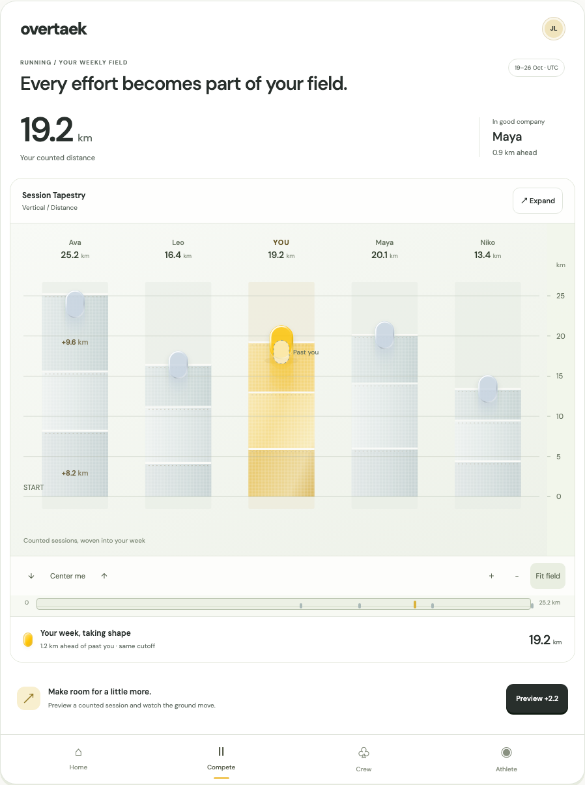
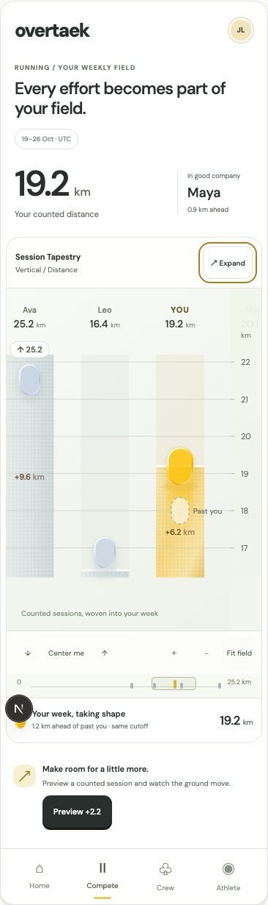
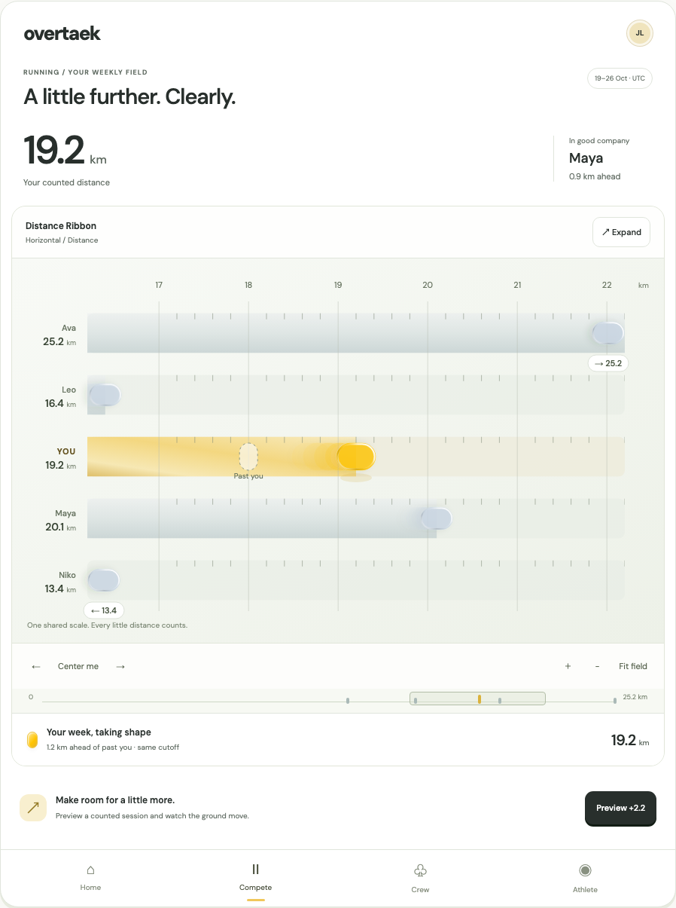
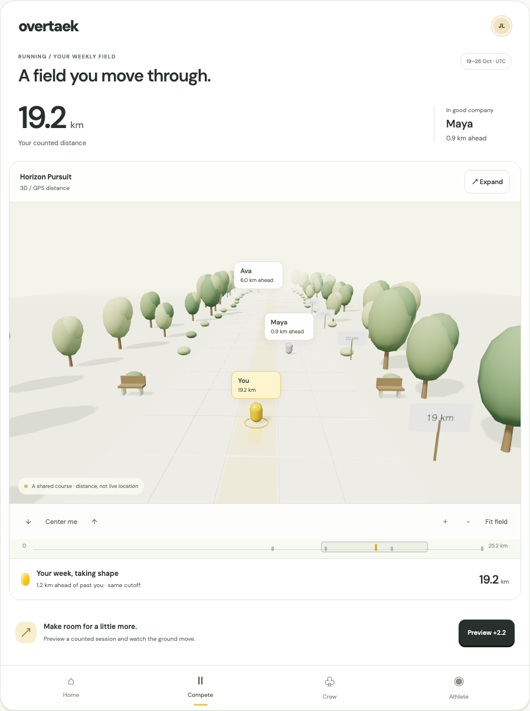

# Compete boards — coded prototype review

October 20, 2026

Open `/design/boards` through the existing design access gate. The design index links to it. Detailed component contracts, direct comparison URLs and the route to production adoption are in [the study README](../../../apps/web/src/app/design/_studies/board-lab/README.md).

Selected scope: Session Tapestry and Distance Ribbon as 2D candidates, each in horizontal and vertical orientations; Horizon Pursuit as the GPS-distance 3D candidate with fixed scenery. The running and strength fixtures, counted sessions and gain previews are local fictional data. Production Compete, backend scoring, activity privacy and native surfaces are unchanged.

## Review captures

### Tapestry — full-week context

### Tapestry — phone

### Ribbon — horizontal comparison

### Horizon — 3D distance course

## Verification

- `pnpm typecheck` passes across the monorepo; the production build also validates application types.
- `pnpm test`: 501 tests pass across shared, rankings, pursuit, mobile and web; five existing database-dependent web tests remain skipped. The new study adds five presentation-geometry/fixture tests.
- `pnpm build:web` passes on Next 15.5.27, including `/design/boards`. Three.js remains lazy-loaded for the 3D selection.
- Browser checks use local supported demo authentication and Chromium software WebGL, not production accounts. [Recorded browser assertions](browser-verification.json) cover fixed marks moving during pan, unchanged totals on pan, session inspection, finite gain, persistent SVG and WebGL expansion, Escape/focus return, units, dynamic reduced-motion preference and WebGL fallback.
- Both 2D materials and both orientations were checked at 320, 390, 768 and 1440 px with no page-level horizontal overflow. The vertical scale stays pinned while browsing lanes.
- A separate resize/expansion check retains a phone lane scroll position of 40 px through expansion, a 1440 px resize, return to 390 px and collapse (40 px afterward).
- Horizon Fit field switches to overhead and displays all five sample athletes. Context loss falls back to a 2D field with the same values and viewport.
- Narrow-screen field controls retain at least 44 × 44 px targets at 320 px. Dragging on a woven session pans the expanded field without accidentally opening the receipt.
- No browser runtime errors were reported in the interaction pass. No dependency or lockfile changes were needed.

These checks establish prototype behavior in the browser. They do not establish native parity, mobile GPU performance, actual tracker connectivity or motivation outcomes from user testing. A production adapter still needs authorized canonical session contributions; missing peer history must remain a continuous unsegmented band.
