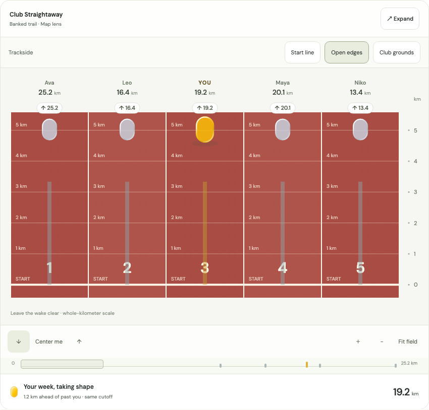
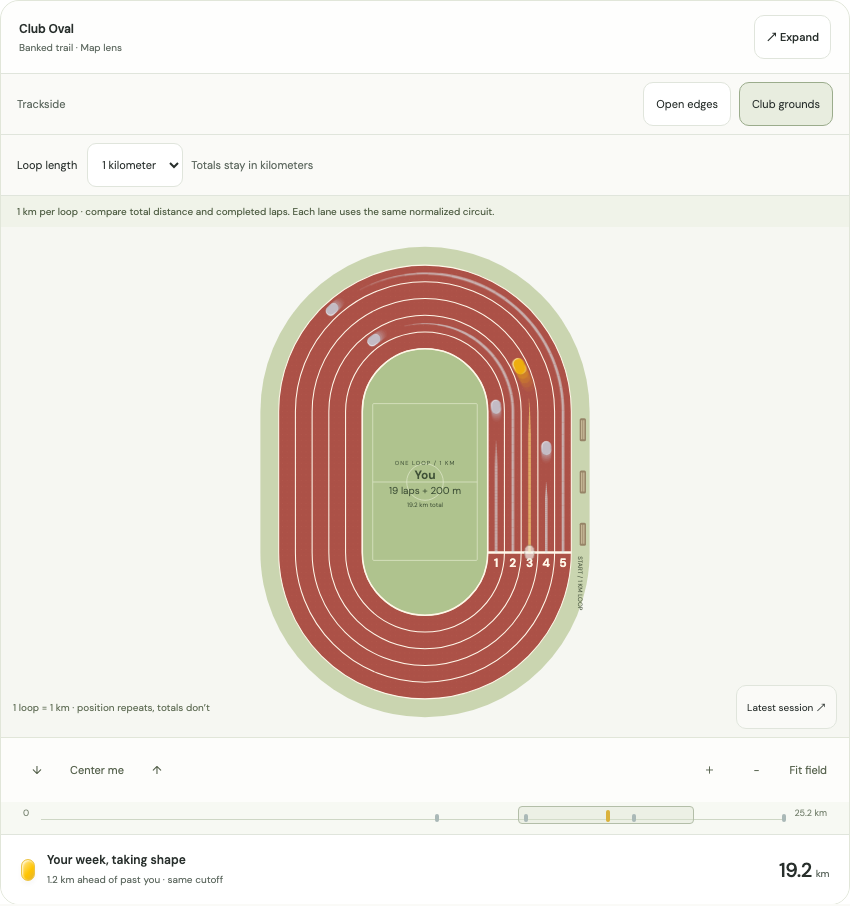

# Club tracks and selected field direction

October 20, 2026 · protected `/design/boards` study

The accepted catalog keeps Personal track, Road ribbons, Parkland Passage, Pool Deck, Boardwalk, Meadow Trail and Night Meet. Contour Atlas is retired. The default is **Meadow Trail + Banked trail + Map lens**, with distance-only zoom retained as an alternative. Custom fields remain a future product extension; this follow-up does not ship an editor or production/native field picker.

Two red athletics surfaces join the seven accepted grounds, for nine fields in total. Product chrome retains Open Field colors; red is reserved for the sports surface.

## Club Straightaway

Red rubber grain, white lane boundaries and whole-kilometer cross-track splits. The numbered start stays at distance zero. `Start line` moves the camera there while preserving all totals. There are no fractional-kilometer horizontal rules.

[Club grounds](straight-club.png) · [Open edges](straight-open.png) · [Numbered start](straight-start.png) · [Phone](straight-phone.png)

## Club Oval

A closed stadium circuit with concentric white lanes and a numbered start. Switch between a **1-kilometer and 1-mile loop**; accumulated totals remain in kilometers. Each lane is normalized to the chosen loop distance, rather than claiming a regulation 400m geometry or a literal GPS route. Completed laps and remaining distance distinguish repeating positions; every marker exposes its total and lap count to assistive technology, and the selected athlete has an infield summary.

The earned trace shows the current circuit and leaves the capsule and its complete tangent-aligned wake clear. A gain crossing 20 km increments the lap count rather than resetting the accumulated total. Map zoom scales the closed world in both dimensions; Fit field restores the full circuit. The Distance only lens unfolds it into continuous straight distance lanes. The bottom overview continues to show the entire accumulated-distance field.

[Club grounds](oval-club.png) · [Open edges](oval-open.png) · [Closer map zoom](oval-close.png) · [Phone](oval-phone.png)

## Verification

- `pnpm typecheck` passes across the monorepo after incorporating current main.
- `pnpm test`: **547 pass**, with five existing optional database tests skipped. Four new tests cover normalized lap boundaries, mile conversion, closed/continuous arc-length geometry and the accepted field catalog.
- `pnpm build:web` passes on the combined current-main and follow-up code.
- [Browser assertions](browser-verification.json): **135** background/progress/viewport combinations at 1440, 390 and 320 px, no page overflow, whole-kilometer marks and five wake exclusion masks.
- Interaction checks cover numbered starts, Map zoom, full-oval fit, persistent expansion and Escape focus return, session inspection, gain from 19.2 to 21.4 km across lap boundaries, mile-loop conversion with unchanged km totals, URL restoration and distance-lens unfolding. No browser runtime errors.
- No production scoring, account preferences, native renderer, dependency or lockfile changes. Browser software rendering does not establish mobile GPU performance or native gesture parity.

The first PR targets `main`. This follow-up is stacked on that branch to keep its diff focused; retarget it to `main` after the first PR merges. Renderer contracts and the production adoption boundary remain in [the study README](../../../../apps/web/src/app/design/_studies/board-lab/README.md).
