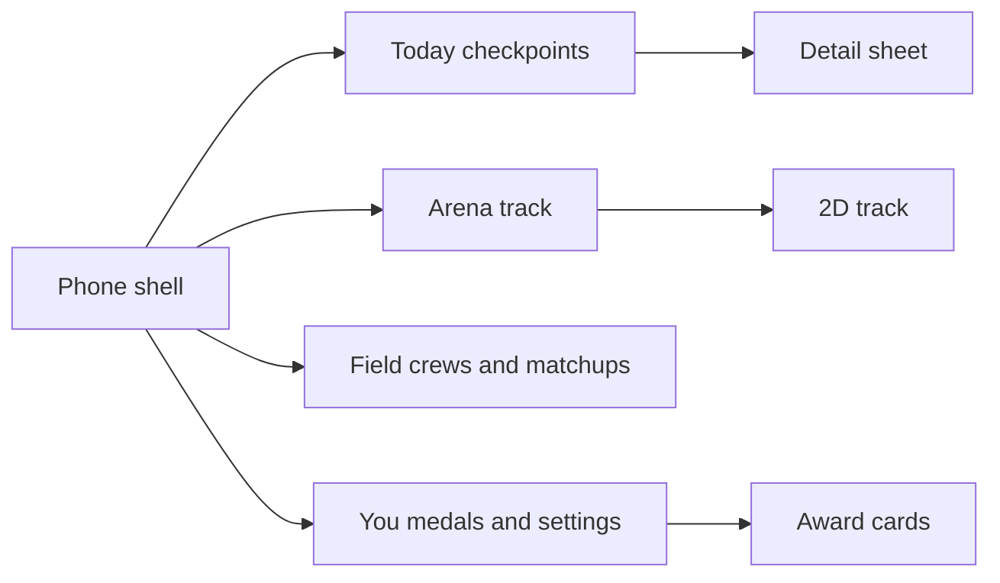

# Rebuild both apps from the Goalmaxxing phone UX

> Selection update (October 16, 2026): Focus is now the production direction, with Trail’s Crew layout and Elo/benchmarks at the top of Athlete. The live Arena keeps vertical 2D/3D lanes with a user-centered window; replay and what-if controls are removed. See [the current design guide](design-guide.md) and [implementation notes](focus-implementation.md). The original plan below is retained as history.

Fitness Battle already has two frontends: [apps/web](apps/web) (Next.js) and [apps/mobile](apps/mobile) (Expo). They should show the same product. When a choice conflicts, the phone app wins. The web app stays long term and may add web-only pieces, but it does not get a different information architecture.

Goalmaxxing is a Next.js app built to feel like a phone. We use that UX as the baseline for both Fitness Battle apps: one shell, a bottom tab bar, a page that keeps its tab when a sheet opens on top, optimistic tab highlight, and tab data that is warm before you tap. We do not copy Cadence screens, coach, or XP. On Expo we rebuild those patterns with a native library. On the web we can adapt Goalmaxxing’s shell more directly.

## Keep the novel UI

Functionality, data, and the custom screens we already like stay. They move into the new shell and sit in the new component language. They are not redrawn from a kit.

- **Checkpoints.** The winding Today view: past counted sessions, Ace on today’s suggestion, blank future nodes, and the return that opens Arena when there is new counted progress. The route, discs, and mascot stay. Buttons and labels around them can be replaced.
- **2D competition.** The lane track and the standings it draws from. Same model, same lanes. The toggle, replay, and surrounding totals can be restyled.
- **3D competition.** The existing pursuit render stays on the web Arena, switched with the 2D track. Mobile embeds the same `/arena-scene` renderer. It is not replaced by a chart from a library.
- **The data under those views.** Compete state, period standings, sessions, and crews. `@fitness-battle/shared`, Supabase, and the tracker and crew APIs stay.

## Replace the generic chrome

Anything that is just a control, not a Fitness Battle idea, can go.

- Button stacks, button styling, and awkward action rows.
- Old dashboard cards, slogan headers, and form chrome that is not the track or the checkpoint route.
- Empty states, sheets, inputs, and list rows, rebuilt with HeroUI Native on the phone and Radix on the web.

A checkpoint disc is kept. The button under it is not.

## Libraries, mixed on purpose

One library per platform. Shared look comes from tokens (plum, tennis yellow, paper, Star Ember, radius, type), not from one component package running in both apps.

- **Expo (priority):** HeroUI Native for buttons, cards, sheets, inputs, avatars, and lists. It is themed with CSS variables, so Fitness Battle colors replace the default theme. gluestack-ui v5 is the fallback only if we need to own copied component source. We do not install both.
- **Web:** Tailwind plus the Radix primitives Goalmaxxing already uses (dialog, tabs, scroll area). Magic UI is only for motion on top of that shell (tab highlight, number change). It does not define layout.
- **Dribbble and Behance kits** are pictures, not code. Use them when judging card spacing and shelves. Do not import them.

Libraries supply buttons, sheets, inputs, and rows. They do not replace the checkpoint route, the lane track, or the 3D pursuit.

## Same four tabs

Each tab is its own screen. A receipt, coaching tip, or person opens in a sheet over the tab you were on. The tab bar never drops you into a different app.

- **Today.** Winding checkpoints. Past nodes are counted sessions. Ace stands on today and opens the real suggestion. Future nodes are blank. A return with new counted progress opens Arena first, then Today.
- **Arena.** The track and the arrival total. No settings under the track. Web also offers the existing 3D pursuit.
- **Field / Crew.** Private crews and shared week activity. Practice 1v1 was removed.
- **You.** Portrait, rating, tracker connections, and a medal shelf. Goalmaxxing goal cards become week-award cards.

Onboarding and login sit outside the tabs. On a wide web window the same phone column stays centered. Desktop-only layout, if any, comes after the phone screens are right.

## Where the code goes

- Shared tokens and tab names in [packages/shared](packages/shared), as plain data. No React Native or DOM imports there.
- Expo screens in [apps/mobile](apps/mobile), HeroUI Native provider in the root layout. New tab routes replace the current single home screen.
- Web shell in `apps/web/src/shell/` and `apps/web/src/ui/`, screens in `apps/web/src/features/today|arena|field|you/`. Arena mounts Focus [arena-lanes](apps/web/src/features/focus/arena-lanes.tsx) and [live-pursuit](apps/web/src/features/field/components/live-pursuit.tsx).
- API routes stay. The current checkpoints-home branch is not the base to keep patching.

## Component redesign

This pass restyles the chrome around the views we are keeping. It does not redesign the checkpoint route or the 2D and 3D renders.

- **Chrome.** New tab bar, boot splash (Overtaek OVERTAKE → OVERTAEK animation; spinner if data still loads after the mark settles), and account entry. The four tabs still open the same Today, Arena, Field, and You content.
- **Buttons and rows.** Throw out the current button layouts. One primary action, one row height, library styling on both apps.
- **Sheet.** The receipt, coaching tip, and athlete detail keep their content. The sheet itself is a library component.
- **Track frame.** View switch, gain line, and window controls. Production uses Focus arena-lanes and live-pursuit; older lab lane-track lives under `design/_studies/shared`.
- **Award card.** Week results use the goal-card shelf. This is a new frame for a result we already compute, not a new sport.
- **Empty and guest.** Short line and one action. No slogan hero.
- **Motion.** Tab pill and sheet come from the library. The return reveal and the track replay stay the ones we have. Reduced motion snaps to the end state.

## Order of work

1. Tokens and the phone shell on Expo, with empty tabs.
2. Expo Today, Arena, Field, and You, including checkpoints, the 2D track, sheets, and award cards.
3. Web shell and the same four screens, plus the 3D track on Arena.
4. Component pass across both apps so sheets, cards, rows, and motion match.
5. Tab cache on the web, matching Goalmaxxing’s warm-tab behavior. Phone keeps the screen you left.
6. Remove the old Rally dashboard chrome only after these routes are the product.
