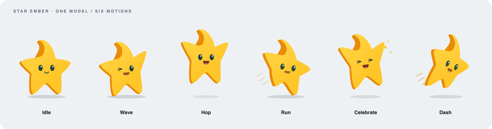

# Star Ember: one character model

Star Ember is a connected, deformable vector character based on the four pose references supplied on October 15, 2026. The canonical source is `packages/shared/src/mascot/`. It contains the silhouette, palette, deformation rules, face, vector layers and animation keyframes. Web, native and SVG export all render the **same display list**. A new expression or motion does not require drawing another mascot.

Review it on web at `/design/mascot`, or in the Expo app at `/mascot`. The web studio provides six motion clips, six expressions, time scrubbing, replay, speed, looping, pose controls, optional ground shadow, and SVG/JSON download. These are dedicated review surfaces. Production `Ace` / `AceStrip` continue to use their approved bundled artwork until a product surface explicitly adopts the new component.



## What kind of model is this?

This is a **2D parametric vector rig with simulated depth**. A rig means that the art has controls: raise a star point, bend the crest, fold a foot, blink, look somewhere, smile, stretch or lean. An animation is a timeline of values for those controls. The model is sampled at a time to produce one pose; the renderer turns that pose into vectors.

The references vary their proportions and perspectives between drawings. This implementation establishes one repeatable interpretation, rather than tracing every generated pose independently. Preserve these character traits when refining the source:

- Five connected points, with a distinctive crest curving toward screen-left.
- Broad shoulders, rounded tips, two tapered feet and a soft inner notch.
- Golden face, orange thickness and crescent, deep green oval eyes with small light glints.
- A centered, simple face independent of body deformation. No added hands, shoes or equipment.
- Ground shadow and sparkles are separate layers; the character background stays transparent.

The turn control horizontally foreshortens the body and shifts the face. It supports modest front/three-quarter poses. It **does not** provide a real side view, back view, 360° rotation, lighting simulation or a skinned 3D mesh. The source reference's exact side profile needs additional art or a 3D model if it becomes a requirement. The run clip is an expressive in-place stride; move the containing component through the app layout for travel.

## Representation choices and research

| Representation | How it works | Fit for Ember |
| --- | --- | --- |
| Procedural vectors — implemented | Editable curves plus numeric controls generate the character every frame. SVG on web; native SVG on mobile. | Strong fit for a small, flat character whose source should live in code. Easily reviewed, versioned and tested. |
| Rive | An author creates vector art, rigs, timelines and interactive state machines in the Rive editor, then apps load a `.riv` asset. | A strong next step when an animator needs visual authoring and more elaborate blended interactions. Runtime libraries are open source under MIT; that is distinct from the editor/export workflow. |
| Lottie | Apps play animation data exported from an authoring tool, commonly as JSON. | Useful for authored sequences. Feature support differs across renderers, so verify shapes/effects on both platforms. A Lottie JSON file is not automatically a freely poseable character rig. |
| 3D / glTF | A mesh, materials, bones or shape keys and animation tracks form a spatial character. | Appropriate for real turns and camera/light interaction. Requires explicit modeling and more rendering infrastructure than these flat references need. |
| Raster frame sequences | Play pre-rendered image frames. | Useful for fixed hand-drawn motion. New poses need more frames, and images do not expose the shape controls requested here. |

Sources consulted:

- [Expo SDK 54: react-native-svg](https://docs.expo.dev/versions/v54.0.0/sdk/svg/): supports native SVG primitives, interactivity and animation; `15.12.1` is the SDK's recommended version and is included in Expo Go. This is the only added runtime dependency, in `apps/mobile`.
- [Rive runtimes and licensing](https://rive.app/docs/runtimes/getting-started): web, React and React Native runtimes; MIT licensing and platform feature considerations.
- [Rive state machines](https://github.com/rive-app/help-center/blob/master/runtimes/state-machines.md): combining animations through application-controlled inputs.
- [Lottie feature support](https://github.com/airbnb/lottie/blob/master/supported-features.md): cross-renderer limitations and fallback behavior.
- [Reanimated: animating styles and props](https://docs.swmansion.com/react-native-reanimated/docs/fundamentals/animating-styles-and-props/): native animated props are a future performance option if several characters must run concurrently. It is not installed speculatively.
- [Three.js ExtrudeGeometry](https://threejs.org/docs/pages/ExtrudeGeometry.html): an extrusion can supply depth to a 2D shape, but making a deformable, production 3D character also requires decisions about mesh deformation and facial surfaces.

## Source map

| File | Owns |
| --- | --- |
| `packages/shared/src/mascot/model.ts` | Versioned proportions, palette, cubic control points, pose types, expression presets, input bounds and deformation fields. |
| `packages/shared/src/mascot/motion.ts` | Six deterministic clips and smooth interpolation. |
| `packages/shared/src/mascot/scene.ts` | Platform-neutral layer tree, shading, face and transparent SVG serialization. |
| `apps/web/src/components/mascot/ember.tsx` | Stateless DOM SVG adapter. |
| `apps/web/src/components/mascot/animated-ember.tsx` | Reusable animated web component. |
| `apps/mobile/src/ui/mascot/ember.tsx` | Stateless `react-native-svg` adapter. |
| `apps/mobile/src/ui/mascot/animated-ember.tsx` | Reusable native playback component. |

`@fitness-battle/shared/mascot` has no React, Next, Expo, native or DOM imports. Both adapters change element names only. All coordinates, paths, colors, transforms, clipping IDs and facial features originate in shared code.

The neutral viewBox includes headroom for the hop. Body and crescent control points pass through the same weighted deformation. The body and face clip path are generated from the same contour. Lowering or raising a point keeps a continuous outline, with unchanged path topology. Each SVG instance gets its own gradient and clipping IDs.

## Using the model

Web:

```tsx
import { AnimatedEmber } from "@/components/mascot/animated-ember";
import { Ember } from "@/components/mascot/ember";

<AnimatedEmber action="celebrate" loop={false} restartKey={successCount}
  className="mascot" />
<Ember expression="wink" pose={{ armRight: 0.8, crest: 0.2 }} />
```

Give the animated component a sized container, for example `.mascot { width: 160px; }`. Use `playing={false}` to pause it. Change `restartKey` to trigger another one-shot without remounting.

Native, inside an Expo Router screen:

```tsx
import { AnimatedEmber } from "../src/ui/mascot/animated-ember";
import { Ember } from "../src/ui/mascot/ember";

<AnimatedEmber action="wave" size={160} active={isItemVisible} />
<Ember expression="happy" size={72} shadow={false} />
```

Drive an explicit static pose, or compose with another animation system:

```ts
import { sampleEmber, blendEmberPoses } from "@fitness-battle/shared/mascot";

const pose = sampleEmber("hop", 600); // milliseconds; a pure function
const looped = sampleEmber("run", elapsedMs, { loop: true });
const transition = blendEmberPoses(previousPose, pose, 0.4);
```

Public actions: `idle | wave | hop | run | celebrate | dash`.

Expressions: `smile | happy | wink | joy | surprised | focused`. Omit `expression` to use the clip's face. An expression preset overrides its relevant channels while other channels, such as a normal blink, can continue. Direct numeric pose controls offer finer control than the presets.

Pose translations are viewBox units; rotation is degrees. `yaw`, `crest`, star-point/foot controls, gaze and smile are bounded to `[-1, 1]`. Eye openness, mouth opening and effects are `[0, 1]`. `scaleX` / `scaleY` provide squash and stretch. Inputs are sanitized; exporting or scrubbing does not mutate the canonical model.

Application state chooses the action: welcome → wave, waiting → idle, completed effort → celebrate. Animation does not write to application/domain state. Use a textual message to communicate success or progress rather than making the mascot the sole state indicator.

## Motion, accessibility and performance

Playback uses one requestAnimationFrame clock per active component, publishing at most 30 poses per second. The shared sampler is deterministic and has no timers. It clamps a one-shot to the final rest pose and wraps loops. Clips enter and exit at rest. Switching actions resets to rest; automatic crossfades between interrupted clips are not implemented, though `blendEmberPoses` is available for that integration.

Web playback pauses when the document is hidden or the host leaves the viewport. Native playback pauses when its route loses focus, the app backgrounds, or `active` is false. Set `active` from list visibility for offscreen native items. Neither platform catches up after a hidden interval. Effects and animation callbacks are removed on unmount. Static studio thumbnails are memoized and use precomputed poses.

Reduced Motion is honored by default on both platforms, including preference changes. The web studio has an explicit, temporary “Preview motion anyway” option for authoring; reusable product components do not expose that override. The initial server/first-render frame is conservatively still until the preference is read. Decorative characters are hidden from accessibility. Pass `label` only when an image description is useful.

The native implementation updates React/SVG on the JS thread. This is a practical starting point for one small character, not a measured guarantee for many simultaneous characters or older devices. Profile on actual phones before broad production adoption. Consider Reanimated/Skia or a Rive runtime if measured performance or animator requirements warrant it; moving this arbitrary scene generation function onto a worklet is not automatic.

## Art exports and regeneration

`ember-neutral.svg` is transparent, scalable artwork. `ember-pose-sheet.svg` and its PNG preview show samples of the six clips. `star-ember-model-v1.json` contains the geometry, palette, rest controls and clip data. The JSON is an inspectable data export for **this** TypeScript implementation; it is not a `.riv`, Lottie or glTF file and does not contain the deformation/renderer algorithms. Keep the versioned TypeScript source with it.

Regenerate the SVG and JSON files from the current source, from the repository root:

```sh
pnpm exec tsc packages/shared/src/mascot/index.ts \
  --outDir /private/tmp/fitness-battle-ember-model \
  --target ES2022 --module commonjs --moduleResolution node --skipLibCheck
node packages/shared/scripts/export-mascot.cjs \
  /private/tmp/fitness-battle-ember-model docs/mascot
```

The studio's **Export pose** captures the current pose, expression and shadow setting as a standalone SVG. **Model JSON** additionally includes the current preview settings. Neither export requires a network service.

If moving to Rive, import the neutral SVG as a starting drawing, then explicitly author the deformable points/bones and facial controls, clips and state machine in the editor. Keep gold, crest, orange edge and expression traits consistent. Preserve the application action names as an adapter contract, and validate on every intended runtime. There is no automatic conversion of these weighted TypeScript controls into a finished Rive rig.

## Verification

`pnpm typecheck`, `pnpm test` (171 tests) and the production web build pass. Shared mascot tests cover finite/sanitized inputs, deterministic sampling, loop endpoints, reduced-motion poses, local point deformation, consistent closed contour topology, isolated/resolved IDs and valid export attribute names. Native visual/runtime review remains outstanding.

Browser review confirmed playback/pause, expression selection, right-point deformation, keyboard scrubbing and the SVG export completion message. Layout checks found no horizontal overflow at 390 px or 320 px. Screenshots are `studio-desktop.jpg` and `studio-phone.jpg`; the page console reported no warnings/errors during the final check. The in-app browser's download-event capture timed out, so actual downloaded-file delivery was not verified there. SVG/JSON generation was verified independently through the export script and shared tests; the generated assets are included in this folder. Device/system preference changes and native animation performance were not manually exercised.

An attempted iOS Metro export stops in the existing Expo Router entrypoint: `@expo/metro-runtime` cannot resolve under the repository's current mobile manifest/Metro resolver configuration. This happens before the new component loads and is also recorded in the earlier production mascot notes. `react-native-svg` matches the installed Expo SDK's `bundledNativeModules.json`. Typechecking does not establish appearance or animation performance on a physical device.

The installed Next.js 15.5.27 package has no `dist/docs/` directory. For the new route, the package README's documentation link and the official [server/client component](https://nextjs.org/docs/app/getting-started/server-and-client-components) and [page convention](https://nextjs.org/docs/app/api-reference/file-conventions/page) guides were used as a fallback. No framework upgrade was needed.
