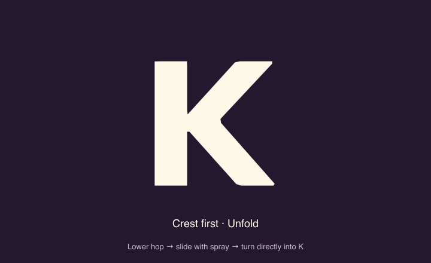

# Front-foot skid candidate

Review `/design/mascot/skid`. The approved sequence now drives the web and mobile application loading screens. With “Rotate into K” enabled, this study embeds the production web loader directly. `/design/mascot/launch` and its quick-stop timing remain available for comparison; `/design/mascot/motion` retains the earlier loading experiment in an archived study component.

`sampleEmberSkid()` uses the crest-first crouch and orbit with a lower, shorter hop. Backward flight starts earlier.

The return now turns above O before the halfway point, then descends continuously into touchdown. The original orbit's low dip and climb are removed from this candidate. Ground clearance is measured from the deformed soles, including body rotation, perspective scale, and the SVG's bottom anchor; the lower sole stays airborne until 3.29s. Perspective scale joins smoothly through the return so it cannot create an apparent second hop. The enlarged preview and exported GIF compensate for their larger character scale while retaining their compressed travel distances.

The landing has three connected beats:

- **Touchdown at 3.29s:** reach the ground before the final seat, with roughly 1.2em still to travel. The accelerating air pass and the grounded slide share their entry velocity.
- **Slide for 432ms:** brace on Ember's left foot (screen right), keep the rear leg light, and lean back slightly. Small changes in travel rate and torso rotation suggest friction without reversing direction or bouncing the supporting sole.
- **Turn directly into K after stopping:** recovery and morph start together at 3.72s and finish at 4.46s. The arm lowers and the body rotates while the limbs become the K; there is no intermediate standing hold. Uncheck “Rotate into K” to inspect the upright Ember endpoint instead.

`launchSkid` pins the front sole to a fixed rail in the vector's local ground plane. The body can rotate, compress, and recover around it; the host supplies the forward slide. A separate deterministic emitter continually throws fresh grains and light puffs backward from the supporting toe for the full slide, then lets the last grains disperse. Its ground anchor stays fixed during the final morph. The airborne rear foot does not emit dust. Existing `launchSkid=0` scenes retain their earlier geometry and effects.

E stays still until Ember reaches its original position during the skid. Its movement follows Ember’s horizontal pass rather than an early timer. A shared 0.14em spacing correction shifts both E’s final seat and K’s final seat, opening a small visible A–E gap while preserving E–K spacing.

The authoring wordmark measures a zero-height baseline marker aligned with its live text. K uses Nunito Sans's exact .705em cap height, matching the extracted outline's 288-unit height. This replaces the approximate baseline inferred from the slot's nested line box, keeping the initial and final K aligned with E and the other capitals across responsive sizes.

The enlarged demo shows a ground-contact guide and finish marker during the landing. The wordmark uses the same clock and rig without this authoring guide. A landing-only replay runs the approach, slide, and combined turn-to-K finish, while the full replay retains the complete K → Ember → K sequence. Both respect Reduced Motion and stop when the tab is hidden.

Tests cover continuous downward travel without premature ground contact, forward-only sliding, continuous horizontal velocity at touchdown and rest, a constant sole height, the raised rear foot, non-crossing silhouette throughout the weight transfer, exact recovery, simultaneous turn/morph, later E movement, spacing, sustained spray, and Reduced Motion. Web and native share the same model; native bundle verification is separate from on-device visual review.

## Product integration

Both loaders play the same 4.8-second `sampleEmberSkid` sequence with `returnToK: true`, including the crest-first shape, launch bend, foot pinning, spray, delayed E displacement, and combined recovery/morph. They preserve the existing data-ready gate: the animation finishes once, then the final wordmark waits if data is still loading. Reduced Motion settles immediately; hidden tabs/background apps pause playback and resume from the saved progress. The web baseline marker and the native baseline-aligned zero-height slot align K to the live letters. The native host scales around the same SVG bottom anchor as the web host.

Today’s checkpoint and greeting already render `AnimatedEmber`, backed by `createEmberScene`. Rally’s `Ace` adapter and the mobile `AceStrip` now render this same vector model for Star Ember. These appearances use their existing action clips or a static rest pose, rather than replaying the loading choreography. Other mascot variants and the historical image/mesh design experiments remain separate artwork.

Reproduce the animation from the repository root:

```sh
pnpm --filter @fitness-battle/shared exec tsc src/mascot/index.ts --target ES2022 --module commonjs --outDir /private/tmp/ember-skid-model --skipLibCheck
node packages/shared/scripts/export-skid-study.cjs /private/tmp/ember-skid-model/mascot docs/mascot
```


