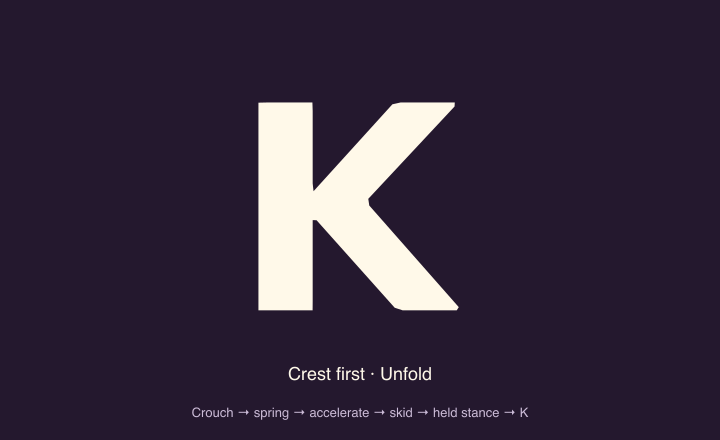

# Held launch poses and sharp landing

Review `/design/mascot/launch`. This follow-up preserves `/design/mascot/motion`, its original anatomical morphs, and the product splash. The page focuses on the preferred `crest-launch` candidate. The earlier `race-launch` candidate remains in the shared model. No product caller opts into them yet.

- **Crest first:** the screen-left arm stays beside the body, the other arm points up, and the legs remain spread. The K maps directly to this stance.
- **Race start:** a forward lean, bent leg, and Ember's left arm raised toward the face. Its shoulder retracts into the body silhouette; a foreground forearm and one faint crease suggest the overlap without a heavy outline.
- Both morphs retain their stance at zero morph. Flight releases the held shape using joint arcs and the existing wind deformation, then restores it on landing. They never pass through the neutral standing endpoint.

`sampleEmberLaunch()` is a deterministic, platform-neutral 4.8-second clock. Crest first now has three distinct motion beats:

1. **Load and spring:** lower the torso 30 viewBox units into curved knees, keeping both soles fixed. Release the bend through a short extension and a separate upward jump arc before cruising.
2. **Accelerate:** reuse the existing orbit around the O, then take a direct pass across the letters with increasing horizontal velocity. Keep the wind deformation, deeper trailing side walls, and speed marks until touchdown. The return is not eased to a stop in midair.
3. **Skid:** touch down at full speed, then scrub off the remaining horizontal momentum over 144ms. The accelerating pass and cubic skid share their entry velocity and resolve to the exact final seat. Bend into the catch after contact, recover into the held stance, and fold directly back into K if requested.

Two larger deterministic dust plumes follow the animated soles, including the body's rotation and compression. They kick outward from both legs at touchdown, while Ember is still sliding, then disperse. Cloud puffs, larger clods, and short ground strokes make the stop visible at wordmark size. Effects expire and travel stays stopped after the skid.

The authoring page synchronizes the enlarged crest-first demo and wordmark, with crouch, jump, fast-pass, skid, and landed checkpoints. Replay is finite, stops in a hidden tab, and settles immediately under Reduced Motion. Manual pose inspection remains available; dust stays disabled under that preference. The existing OVERTAKE → OVERTAEK letter swap is preserved in the wordmark copy.

The generic web and native SVG renderers accept the new options. This is a browser-reviewed prototype; it does not install the new sequence as the production loader or checkpoint animation. Native compilation is checked separately from on-device visual review.

Geometry tests sweep the full morph and flight transition for finite, non-crossing outlines, compare the launch and recovered stance, check planted soles through the knee bend, require increasing return-pass speed, and verify skid continuity and two-foot dust timing. To reproduce the animated proof from the repository root:

```sh
pnpm --filter @fitness-battle/shared exec tsc src/mascot/index.ts --target ES2022 --module commonjs --outDir /private/tmp/ember-launch-model --skipLibCheck
node packages/shared/scripts/export-launch-study.cjs /private/tmp/ember-launch-model/mascot docs/mascot
```



[Earlier two-candidate proof](ember-launch-and-landing.gif) is retained for comparison.
