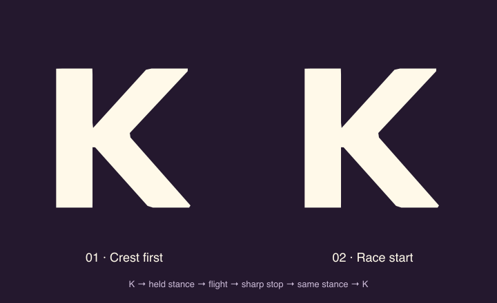

# Held launch poses and sharp landing

Review `/design/mascot/launch`. This follow-up preserves `/design/mascot/motion`, its original anatomical morphs, and the product splash. It adds two separately named candidates, `crest-launch` and `race-launch`, to the shared vector model. No product caller opts into them yet.

- **Crest first:** the screen-left arm stays beside the body, the other arm points up, and the legs remain spread. The K maps directly to this stance.
- **Race start:** a forward lean, bent leg, and Ember's left arm raised toward the face. Its shoulder retracts into the body silhouette; a foreground forearm and one faint crease suggest the overlap without a heavy outline.
- Both morphs retain their stance at zero morph. Flight releases the held shape using joint arcs and the existing wind deformation, then restores it on landing. They never pass through the neutral standing endpoint.

`sampleEmberLaunch()` is a deterministic, platform-neutral 4.8-second clock. It reuses the current wordmark orbit geometry, adds an anticipation beat, and joins the return path with matching position and velocity. The last 120ms use a sharp cubic deceleration. A brief compression and one deterministic dust burst at the planting foot sell contact. Travel stops after contact; particles expire. `returnToK` folds directly from the recovered launch stance.

The authoring page synchronizes both candidates and the wordmark, with scrubbers and checkpoints. Replay is finite, stops in a hidden tab, and settles immediately under Reduced Motion. Manual pose inspection remains available; dust stays disabled under that preference. The existing OVERTAKE → OVERTAEK letter swap is preserved in the wordmark copy.

The generic web and native SVG renderers accept the new options. This is a browser-reviewed prototype; it does not install the new sequence as the production loader or checkpoint animation. Native compilation is checked separately from on-device visual review.

Geometry tests sweep the full morph and flight transition for finite, non-crossing outlines, compare the launch and recovered stance, and check landing velocity continuity and dust timing. To reproduce the animated proof from the repository root:

```sh
pnpm --filter @fitness-battle/shared exec tsc src/mascot/index.ts --target ES2022 --module commonjs --outDir /private/tmp/ember-launch-model --skipLibCheck
node packages/shared/scripts/export-launch-study.cjs /private/tmp/ember-launch-model/mascot docs/mascot
```


