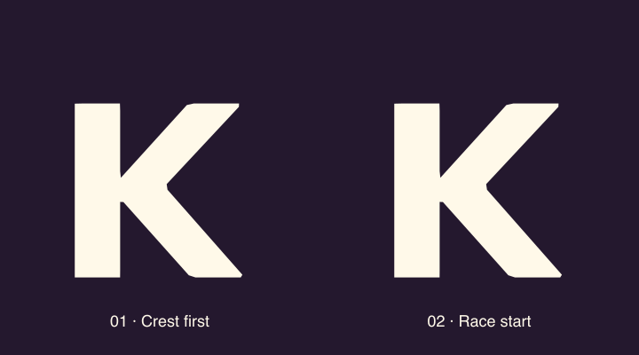

# Ember in the product

Review at `/design/mascot/motion`: replay the production loader, scrub its time,
inspect five morph poses, then advance/rewind a small field using the production
lane and leaderboard components. The field uses explicitly labeled preview data.
`/today` exercises the actual checkpoint and coaching sheet.

## Anatomical morph prototypes

The review page now opens with two candidates, each using explicit anatomical
landmarks along both contours. Corner names below are from the viewer's K;
limb names are from Ember's perspective. Concept 2 incorporates the clarified
bottom-left → right-leg assignment.

| K branch | 01 · Crest first | 02 · Race start |
| --- | --- | --- |
| Top left | Hair/crest | Right arm |
| Top right | Left arm | Hair/crest |
| Bottom left | Right arm + right leg | Right leg |
| Bottom right | Left leg | Left arm + left leg |

Both candidates converge to the same original K and the same resting Ember.
The paired arm and leg occupy separate landmarks on one K branch. This lets
them unfold in perimeter order, without crossing two edges through the body.
Concept 1 holds the right arm alongside the leg before releasing it. Concept 2
gathers the left arm and bent left leg in a starting stance. Source wrists and
foot rotate around the rig's joints while shape keys describe the elbow/cuff;
they retain their reach instead of scaling down. The orange crescent follows
the crest during the morph.

Replay each candidate, **Play both concepts**, scrub either independently,
or toggle colored **Limb guides** to track identities. The loading-preview
selector also places either candidate into the complete production sequence.
The actual application still defaults to `baseline`; selecting a prototype on
this page does not change product settings. Reduced Motion skips automatic
replay to the static Ember endpoint; manual scrubbing remains available.



The source is `packages/shared/src/mascot/limb-morph.ts`. Its tests sweep both
morphs for finite coordinates, winding and edge crossings, check branch
assignments, and check joint reach through the release. To regenerate the GIF,
use the existing TypeScript compiler and Sharp dependency:

```sh
pnpm --filter @fitness-battle/shared exec tsc src/mascot/index.ts --target ES2022 --module commonjs --outDir /private/tmp/ember-limb-compiled --skipLibCheck
node packages/shared/scripts/export-limb-concepts.cjs /private/tmp/ember-limb-compiled
```

The preview clock is shared by the browser and exporter.

## Review and changes

The previous loader moved a mascot around the word but crossfaded to a separate
text K. Its character clip ran independently of its travel, facing snapped between
directions, and a horizontal coordinate changed scale at zero. Unequal path-key
times also produced unequal derivatives at joins. Native positioning mixed word
and stage coordinates and anchored the character to the stage bottom.

The current loader starts with OVERTAKE. Its K unfolds into Ember, travels behind
the word, rounds the O, passes in front and lands after E. E shifts into the vacant
slot, and Ember's same opaque surface reshapes into the final K of OVERTAEK.
The complete sequence retains the existing 3.2-second gate and data-ready policy.

- A non-uniform cubic Hermite path interpolates measured **pixel** positions,
  preserving velocity through unequal key intervals and the return across zero.
- The path's tangent banks the body and directs the trail. Flight strength drives
  folded arms, trailing feet, delayed crest bend and directional thickness, then
  returns them to rest. These remain authored vector mechanics, not simulated
  aerodynamics or a full 3D turn.
- Facing turns continuously through a brief edge-on pose. Depth shrinks Ember
  behind the word and slightly enlarges the return pass; both ends settle at the
  exact wordmark size. The final glyph uses the bundled Nunito Sans Black K.
- Native placement uses the word's measured origin and baseline. Both platforms
  keep the same artwork and morph schedule. Native publishes the vector at 30fps;
  web publishes up to 60fps. Neither is a measured device-performance guarantee.

## Actual shape morph

`morph` is a renderer input: `0` is Ember, `1` is the K. The character's front
contour and the font glyph are sampled at 128 equal perimeter positions with an
authored seam correspondence. Intermediate positions interpolate those points.
The depth surfaces follow the changing perimeter and contract into the letter;
gold resolves to the wordmark color and facial details disappear locally. The
body itself stays opaque throughout. There is no second text K or host crossfade.
At zero, the original cubic artwork is returned unchanged.

The font's K contains an intentional overlapping diagonal. The extraction script
unions that overlap before sampling: a valid filled font outline can otherwise
become a folded edge during interpolation. The seam is checked over 100 morph
samples for consistent winding and no intersecting non-adjacent edges. If the
canonical silhouette or font is changed, regenerate the glyph and review that
correspondence again. Morphing is authored with the resting pose; the loader
separates the morph windows from articulated flight.

Regenerate from the repository root using a temporary Python environment with
`fonttools==4.67.0` and `skia-pathops==0.9.2`, then run
`python packages/shared/scripts/extract-ember-k.py`. These are authoring tools,
not application dependencies. The glyph is derived from the already bundled
`@expo-google-fonts/nunito-sans` font; its [OFL notice](NunitoSans-OFL.txt) is retained.

## Goalmaxxing comparison

The local Goalmaxxing planner's `plan-view-morph.ts` and
`plan-view-transition-frame.tsx` preserve item identities while interpolating
measured boxes and typography, including interrupted transitions. That continuity
is the useful reference here. Layout interpolation alone cannot change the outline
of an unrelated star and letter, so Ember uses explicit contour correspondence.
Leaderboard rows use the existing [Motion layout animation](https://motion.dev/docs/react-layout-animations)
support to carry the same runner through a changed ranking.

## Where motion helps

| Surface | Implemented behavior | Purpose |
| --- | --- | --- |
| Loading | Reversible K ↔ Ember contour, coherent flight and landing | Connect the character and wordmark through one identity |
| Today checkpoint | Vector Ember rests until interaction; waves on web hover/keyboard focus and hops on press-down | Acknowledge the user's action before the sheet opens |
| Today coaching | One greeting wave inside the newly opened sheet | Keep feedback visible while giving immediate access to the recommendation |
| Web lanes | 320ms marker movement and a small selected-marker emphasis | Preserve runner identity when history, data or selection changes; direct track dragging remains immediate |
| Web field/leaderboard | Position-only spring layout for existing runner IDs | Explain a genuine reorder without changing lane identity or data |
| Native lanes | 300ms Reanimated bar-height transition | Explain a changed cutoff using the existing native SVG chart |

Next useful candidates are a single acknowledgment after a **confirmed** activity
sync and a small rank-change cue after a **real** standings update. Those should
depend on persisted events, so reopening the app or replaying history does not
repeat a celebration. The existing continuous 3D pursuit already supplies movement;
adding looping mascots there would compete with the field's information.

## Verification and limits

- Shared tests cover glyph endpoints, winding, edge crossings, opaque surface,
  path velocity at each knot, continuous facing/scale and reduced-motion pose.
- Workspace typecheck/tests, production Next build and iOS Metro/Hermes export.
- Browser review covers phone and desktop wordmark alignment, forward/reverse
  scrubbing, replay completion, Today press/open/close, and field advance/rewind.
- Product animation honors Reduced Motion. The loader settles immediately;
  feedback rests and list/chart transitions become immediate. Existing character
  hooks pause while hidden/offscreen or unfocused; the boot clock pauses while
  backgrounded. Manual authoring scrubs remain available.
- Native code is bundle-verified, not visually checked on a simulator or device.
  Timing and SVG update cost still need an on-device pass. The browser's guest
  account has no enrolled field; ranking transitions were checked with the labeled
  preview, without changing an account's enrollment or standings.
