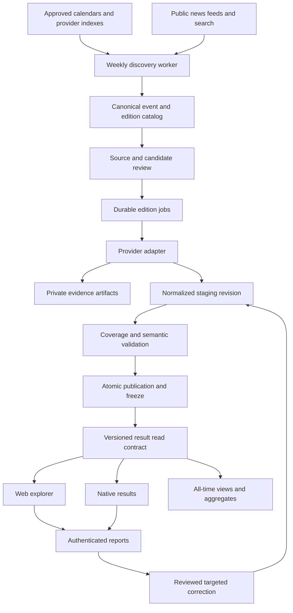

# Race results platform: architecture and delivery plan

Status: November 9, 2026. This branch builds on [PR #580](https://github.com/jerryliu3/fitness-battle/pull/580) (Slice A extraction safety) by delivering **Slice B & C: Publication Gate, Lifecycle & Provider Namespace Widening**. Scheduled ingestion, report service and production migration remain future slices.

Read alongside [detailed acquisition scope](race-results-ingestion-scope.md), [operator instructions](ingestion.md), and [results explorer research](all-time-rankings-research-2026-11-09.md). The acquisition scope supplies source investigations, candidate events, privacy/access policies, acceptance cases and unresolved owner decisions. This document explains component boundaries and implementation dependencies.

## 1. System objective

Maintain a curated archive of major public race results. Discover newly completed editions weekly, acquire each edition once, and use reviewed reports to correct saved data. Event search, result detail and all-time rankings share one archive. Adding a new edition may change derived rankings without changing any historical source observation.

The archive is separate from training activity ingestion and the weekly competition engine. An imported performance cannot automatically award Elo, contribute workout distance, establish an account identity or change a settled competition.

## 2. Current implementation

`packages/rankings` owns parsing, normalization, pagination and SQL emission. `rankings-db` owns a separate Supabase/PostgreSQL ledger. The web rankings UI reads that ledger. Native benchmarks currently include modeled training comparisons and must not be presented as official race results.

The ledger has sources, snapshots, ingestion runs, events, editions, source records and performances. Source display permission and per-performance eligibility determine public visibility. Chip and gun clocks are retained separately. Athlete identity across events remains unresolved.

Implemented in PR #580 (Slice A: Extraction Safety):

- A shared pagination reader using upstream row identities/counts. Excluded youth do not terminate pagination. Empty upstream pages end traversal; repeats, parse failures and exhausted page budgets reject extraction.
- Explicit RunSignup result-set selection. Both metadata and each result page must affirm public visibility and finalized status. Overall/division sets are not silently combined. Nonbinary support is requested explicitly.
- MikaTiming overlap detection. An ignored category filter causes a held import instead of guessed category assignment and silent deduplication.
- New public-list sources default to display disabled. Existing source review metadata, approval and suppression survive imports.
- A guard against source-wide external IDs relocating records into another edition.
- Shared SQL generation for both emitters, safe delimiter handling, corrected normalized snapshot hashes, per-run reports and nonzero failure exits.
- Parser and process-level CLI tests plus a generated rollback-only SQL integration test.

Implemented in this stacked follow-up (Slices B & C: Publication Gate & Provider Namespace):

- **Additive schema**: `event_editions` adds `publication_state` (`draft`, `staged`, `published`, `frozen`), `revision` (integer >= 1), `published_at`, and `frozen_at`.
- **Database transaction-locked publication gate**: Row-locks `event_editions` with `for update`. Ordinary acquisition cannot mutate an already published edition without `--allow-correction`. Frozen editions can never be mutated. Corrections bump revision and require matching prior `expectedRevision` when specified.
- **Provider namespace widening**: Scopes `source_records` external result ID uniqueness to `(source_id, event_edition_id, external_result_id)`. Provider IDs across different editions no longer collide or relocate records.
- **Worker pre-fetch check**: The CLI checks database publication state before scraping. If an edition is already frozen or published (without `--allow-correction`), network requests are skipped entirely.
- **Publication management RPCs**: `public.freeze_event_edition(bigint)` and `public.publish_event_edition(bigint)`.
- **CLI flags & reports**: Added `--allow-correction`, `--freeze`, and `--expected-revision` flags, reporting skipped and published states.

## 3. Target component flow

Discovery gathers candidates; it cannot publish arbitrary source content. Fetching produces observations; it cannot approve access. Validation checks data quality; it cannot establish a reuse right. Publication exposes one approved, consistent revision. Corrections use that same publication path with a different authorized job purpose.

## 4. Ownership and deployment boundaries

| Component | Owner/location | Responsibilities |
| --- | --- | --- |
| Provider adapters | `packages/rankings` | Fetch contract, IDs, pagination, status/category interpretation |
| Portable contracts | Platform-independent shared modules | Result/filter/revision types and deterministic metric rules |
| Ledger and publication | `rankings-db/supabase` | Constraints, staging/public revisions, access grants, audit history |
| Discovery/import execution | Repository worker with scheduled and manual entry points | Scan cursors, bounded execution, job leases, retries |
| Authenticated application service | Server-side application boundary | Verify main-app sessions; authorize reports and operator actions |
| Public read service | Bounded server read contract | Search, paging, aggregates and source/coverage context |
| Platform presentation | Web and native feature modules | Result discovery/detail/report UI using the same data semantics |

Keep credentials server-side and read them through the appropriate environment modules. Do not copy the rankings ledger into the main application database. Do not assume authentication subjects from two Supabase projects are interchangeable.

## 5. Canonical identity

A series is a recurring event family. An edition is a particular occurrence, with a local date/timezone and historical status. A discipline identifies the race within that edition. Year alone is insufficient for repeated events, stages or multiple occurrences.

Provider event IDs map onto canonical identities; they do not define canonical series. Preserve aliases for renamed events and different timing hosts. News articles from several publishers should resolve to the same edition.

A source observation records what one publication said. A canonical performance represents one finish. Multiple result sets or articles may provide observations of that finish. Matching must preserve evidence and ambiguity rather than globally merging identical names.

The next identity migration must widen external-ID uniqueness to the actual provider namespace, usually source plus edition and discipline/result set. Audit collisions before changing constraints. Preserve existing result URLs and IDs; introduce mappings or aliases where needed. Reconcile overlaps before counting performances.

## 6. Discovery lifecycle

A weekly repository workflow starts a bounded discovery scan. Use approved calendars and provider indexes for known series, public news for new prominent events and missing results, and a persisted cursor for outage recovery. The proposed overlapping lookback is 21 days with a 90-day forward calendar window; these are configurable operating choices.

Known approved series can enqueue new editions automatically. New series, changed hosts and changed access contracts require review. Deduplicate candidates before enqueueing. Canceled/postponed editions remain catalog facts without fabricated results.

Published edition IDs are checked before any result-body fetch. An unpublished edition waiting for results stays in the queue after it falls outside the lookback. Availability retries are distinct from refreshing saved results. The initial proposal allows weekly checks for six weeks before operator review.

Do not activate scheduling until manual end-to-end acquisition, duplicate scans, missed-run recovery and published-edition zero-fetch behavior pass.

## 7. Jobs, staging and failure recovery

Jobs carry edition ID, purpose, source/adapter version, approval reference, attempt count, lease expiry, heartbeat, checkpoint and terminal outcome. Purposes distinguish initial acquisition, reviewed correction and explicit recovery. Enforce one active job for an edition/purpose and prevent concurrent publication races.

Store successful page checkpoints so a worker restart need not repeat completed work. Bound requests, response bytes, pages and execution time. Honor host rate limits and retry instructions. A challenge, access denial or changed schema is a held job, not a successful empty result.

Create run records outside the transaction that publishes data. Otherwise rollback erases the evidence of failure. Retain errors without credentials or unnecessary personal data. Keep already published revisions visible when a correction job fails.

Staging is private. Validate the complete candidate revision before promotion. An interrupted initial import must expose no accidental partial field. If partial coverage is intentionally published, record that explicit decision and freeze that publication too.

## 8. Publication and import-once enforcement

Add explicit publication state, revision and timestamp. Do not infer publication from the presence of a performance: existing imports may be partial. Audit and classify legacy editions before backfilling markers.

The worker checks frozen state before fetching. The database rechecks it under a transaction lock before applying changes. Both protections are required: the first avoids needless scraping; the second closes concurrent-worker and manual-CLI races.

Ordinary acquisition cannot mutate a published edition. A correction requires an authorized report/recovery reference, reason and expected prior revision. Reject stale correction previews. Commit performance changes, publication revision, audit entry and aggregate invalidation together. Readers see a consistent old or new revision.

The existing SQL upsert primitive is not itself a publication API. Introduce the gate once, route all writers through it, and retire bypass paths. Avoid a generic force-refresh switch that would erase the import-once policy.

## 9. Evidence, access and retention

News sources primarily identify events and explicitly reported performances. Organizer and timing sources supply complete fields where access and reuse are reviewed. Selected performances can be useful without implying a complete race population.

Source review records attribution, access method, relevant terms/license evidence, reviewed hosts, reviewer and decision date. Imports cannot reverse suppression. Event/result suppression must be available without unnecessarily disabling unrelated data from the same provider.

Private evidence artifacts need retrieval date, canonical source URL, content hash, artifact type, redaction status and parser version. Raw payload retention requires an explicit policy for minors and private registration fields. Do not retain full articles by default. A hash of normalized or redacted content must identify that artifact honestly.

Treat source text and submitted URLs as untrusted. Restrict outbound hosts, reject private network destinations, revalidate redirects, cap response size/type, and never execute page instructions. Public visibility alone is not an automatic bulk publication approval.

## 10. Validation and analytic eligibility

Account for upstream populations before exclusions: entrants, starters, finishers, raw rows and stored eligible adult finishes are different counts. Reconcile by discipline and category after overlap removal. Unexplained discrepancies prevent complete-field claims.

Keep coverage separate from job success and finality. Suggested coverage values are complete, partial, selected results and unknown. A technically successful parser can still produce unverified coverage. Small or incomplete cohorts must not acquire misleading population percentiles.

Retain official placement separately from computed rank. Clock fallback must be visible. Preserve DNF, DNS, DQ, ties and unknown category. Unknown age does not become an invented adult age. Existing known-under-18 exclusion remains in effect unless policy changes explicitly.

All-time queries rank covered comparable performances. They do not establish certified world records or unique-athlete standings. Triathlon separates formats, actual course lengths, relay/individual and professional/age-group fields. Cycling stages, general classification, elapsed times, gaps and points require different models. Swimming separates stroke, distance, pool length and open water. Add sport contracts before expanding database constraints.

## 11. Read architecture

Provide bounded server-side search and pagination rather than fetching the archive into a client. Apply one eligibility predicate to rows, totals, histogram bins and percentiles. Stable paging binds filters/sort to a publication revision and deterministic tie breaker.

An event read returns edition metadata, published revision, coverage/finality, clocks, available categories, eligible count and source attribution. Result detail returns a stable result ID and source evidence. Around-result queries work beyond the initial page. Name search does not recalculate rank among name matches.

All-time boards query the same archive. Derived aggregates can rebuild when a new edition publishes; historical sources remain untouched. Preserve distinctions between performances and people until athlete linking is reliable. Web and native use the same read contract and metric definitions.

## 12. Report and correction architecture

Result and edition screens submit private authenticated reports with reason, target ID, expected revision, explanation and optional public evidence URL. Reasons distinguish incorrect facts, wrong-person links, missing results/events and privacy/removal. Submission never directly edits a performance.

The server validates the main-app session, creates a trusted reporter reference in the rankings service, and authorizes subsequent receipt reads. A user can read their own status, not other reporters or private operator notes. Operator review requires an explicit role; service credentials remain unavailable to clients.

Triage may group duplicate reports into one investigation. Wrong-person claims are resolved in the association layer. Objective race corrections require evidence; conflicting reports remain reviewable. A reviewer sees a before/after diff and confirms the expected revision. Publish an audited correction through the same staging/validation gate, then refresh affected search and cohort aggregates.

Ordinary scheduling continues to skip the corrected edition. No background freshness loop is introduced. Unreported changes may remain stale by design. Assign a reviewer and response expectations before advertising report support.

## 13. Delivery plan and dependencies

| Slice | Required work | Exit evidence |
| --- | --- | --- |
| A: extraction safety (PR #580) | Strict pagination, selected sets, source preservation, collision guard, failure reports | 32 package tests/typecheck passed |
| B & C: publication gate & namespace (this branch) | Additive schema, explicit revisions/freeze, locked database writer, CLI pre-fetch skip, provider namespace widening | Integration test suite covers publication lock, revision bumps, freeze rejection, pre-fetch skips, and edition-scoped external IDs |
| D: jobs and evidence | Durable runs, checkpoints, leases, private artifact retention and parser versions | Worker crash/resume and failed-publication recovery demonstrated |
| E: weekly discovery | Canonical catalog, candidate review, scan cursor, overlapping windows and approved-source scheduling | Manual scan, duplicate/catch-up and published zero-fetch tests pass before activation |
| F: first acquisition batch | Validate official fields, fill half/10K gaps, re-evaluate failed marathon sources | Reconciled fields with explicit coverage, not merely large row counts |
| G: explorer reads | Full-field navigation, event/result detail, consistent aggregates and native contract | Mid-pack lookup beyond row 200, ties, errors and revision-bound navigation work |
| H: report workflow | Auth bridge, private receipts, operator diffs, correction/removal publication | Unauthorized edits fail; approved corrections update rows and denominators atomically |
| I: expansion | One full-distance and one 70.3 spike; agreed historical backfill; next sport contracts | Each provider and format meets the same access, identity and coverage gates |

B and C precede unattended writes. D and E precede scheduling. F depends on reviewed access and completeness. G can progress alongside the pipeline using a stable read contract. H must ship before unattended acquisition is treated as operationally complete. Provider spikes can be investigated early without enabling bulk ingestion.

## 14. Verification, rollout and operational controls

Run focused semantic tests only when the complete implementation slice is ready, in accordance with repository policy. SQL changes need real PostgreSQL tests; string comparisons are insufficient evidence. This PR supplies a generated rollback-only SQL test of the actual importer. Local PostgreSQL execution remains outstanding because psql was absent and the Docker socket inaccessible.

Future gate tests must cover concurrent publication, rollback, source suppression, unauthorized correction, stale revision rejection, ID reuse, repeated editions, hidden/preliminary sets, raw page accounting, crash/resume, discovery overlap, scan outages and zero result-body requests for frozen editions. UI acceptance includes common-name ambiguity, full-field lookup, accurate cohort counts and unavailable-source states.

Roll out in stages: deploy schema and service-only writers; exercise a controlled manual import; inspect coverage and access; publish a limited approved batch; validate reads/corrections; then enable scheduling. Stop acquisition on adapter/schema failures without hiding already valid publications. A bad new publication can be suppressed while preserving its audit trail.

Track last successful scan, queue age, editions by sport/year, availability-to-publication delay, discrepancies, blocked hosts, requests/bytes, parser failures, manual review time and report age. Assign an owner and backup. Separate historical work from current-edition/correction budgets so backfill cannot starve ongoing service.

Budget from observed page sizes and provider request counts. A hypothetical 50,000-row edition at 100 rows/page needs roughly 500 requests before overlap/details. Splits can multiply costs. Measure representative fields before choosing worker concurrency, storage retention and a monthly cap. Avoid adding infrastructure until existing runners are demonstrably insufficient.

## 15. Decisions still open

The owner has not yet selected the initial sport breadth or historical depth. Recommended sequence is running/triathlon first, latest completed editions first, then backward acquisition. Cycling/swimming need explicit comparability contracts. Team sports require a separate scope.

Also resolve the major-event inclusion criteria, whether news-only selected performances publish or remain discovery-only, treatment of unknown finality, evidence retention, source-review ownership, operating budget and report response expectations. These decisions do not block extraction safety or publication-gate engineering, but they do block indiscriminate catalog expansion.

## 16. Local review commands

PR worktree: `/tmp/fitness-battle-rankings-pr`. Original checkout: `/Users/jerryliu/Documents/fitness-battle/fitness-battle`. Unrelated application edits remain in the original checkout.

From the PR worktree, install dependencies with `pnpm install --frozen-lockfile` when needed. Run `pnpm --filter @fitness-battle/rankings test` and `pnpm --filter @fitness-battle/rankings typecheck`. The earlier passing checks were run in the original checkout before PR isolation; no claim is made that SQL was executed or that the isolated worktree was independently retested.

For web review: `cd /tmp/fitness-battle-rankings-pr && pnpm dev:web`, then open `http://localhost:3000/rankings`. For the existing iOS development client: `cd /tmp/fitness-battle-rankings-pr && pnpm dev:mobile`, press `i`, then Compete → Beyond this week. Application behavior is unchanged by this ingestion PR.
