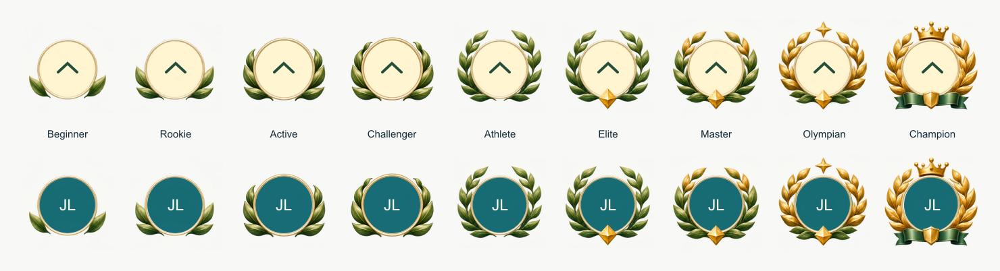

# Ascendant Laurel rank symbols



The nine visual identities follow the reference: Beginner, Rookie, Active,
Challenger, Athlete, Elite, Master, Olympian and Champion. Beginner has one leaf per side, Rookie two, Active three and Challenger four.
Athlete uses the fuller green wreath; Elite uses that same wreath with Master’s gold jewel beneath it.
Master adds gold upper leaves,
Olympian adds a star, and Champion finishes with a gold wreath and crown.

## Use on web or native

Both apps expose `RankSymbol` and `RankAvatar` from `src/ui/rank-symbol.tsx`.
These are opt-in components; no existing screen or avatar is changed.

```tsx
// Web: import from "@/ui/rank-symbol";
// Native: import from the relative path to src/ui/rank-symbol.
import { RankSymbol, RankAvatar } from "@/ui/rank-symbol";

// Standalone medallion for a rank explanation.
<RankSymbol rank="champion" size={112} />

// Transparent wreath composed around the existing avatar, including fallbacks.
<RankAvatar rank="elite" src={photoUrl} name="Jerry Liu" size={96} />

// Bare overlay for custom portrait compositions.
<RankSymbol rank="olympian" variant="frame" size={96} decorative />
```

`size` is the full ornament width and height, including any crown or ribbon.
The portrait diameter is `size * 84 / 160`: a 48px photo needs an ornament of
approximately 91.43px. The ornament reserves its full bounds in layout, so its
leaves and crown don't get clipped by a circular photo container. Use at least
64px for the ornament when space allows; the detailed leaves lose definition
at small icon sizes.

Standalone symbols announce their rank by default. Like `UserAvatar`, composed
avatars are decorative by default beside an athlete's name. Pass
`decorative={false}` to announce both the athlete and rank when needed.

## Shared artwork and custom renderers

The detailed 512×512 transparent PNG frames live in
`packages/shared/assets/rank-symbols/`. Web serves identical copies from
`apps/web/public/rank-symbols/`; native bundles the shared originals through
static imports. Keep these copies identical when updating an asset. No network
image service or new dependency is required.

`packages/shared/src/rank-symbols.ts` exports the rank IDs, names and layout
geometry. Both adapters use the same transparent art for the frame and badge;
the badge adds a softly lit disc and chevron beneath/inside the wreath.

All images use a normalized circular portrait aperture at `(38, 40)`, diameter
`84`, in a logical 160×160 canvas. Custom SVG/3D renderers can load the PNG as
an image/texture and use that geometry. Keep the ornament outside the circular
photo crop. The source artwork was recreated with the built-in image generator
from the supplied reference, then cropped and normalized for consistent sizing.
It closely follows the reference's materials and progression, but is not an
exact extraction of the original artwork.

The generation prompt is recorded in [rank-symbols-prompt.md](rank-symbols-prompt.md).

## Score mapping is intentionally pending

The current scoring ladder has eight bands: Beginner, Developing, Active,
Steady, Strong, Elite, Olympian and Champion. This artwork set has nine and
includes different names. No score thresholds, milestone prices or existing
text badges have changed. Callers select a `RankSymbolId` explicitly until
the nine-band score mapping is decided. Do not infer it by array position.

## Local review

From `/Users/jerryliu/.codex/worktrees/1a44/fitness-battle`:

```sh
pnpm --filter @fitness-battle/web dev
# Or build and launch the native app in the iOS simulator:
cd apps/mobile
pnpm ios
```

These components need to be imported into a screen to appear in the app. The
image above previews the artwork without changing any product screen.
