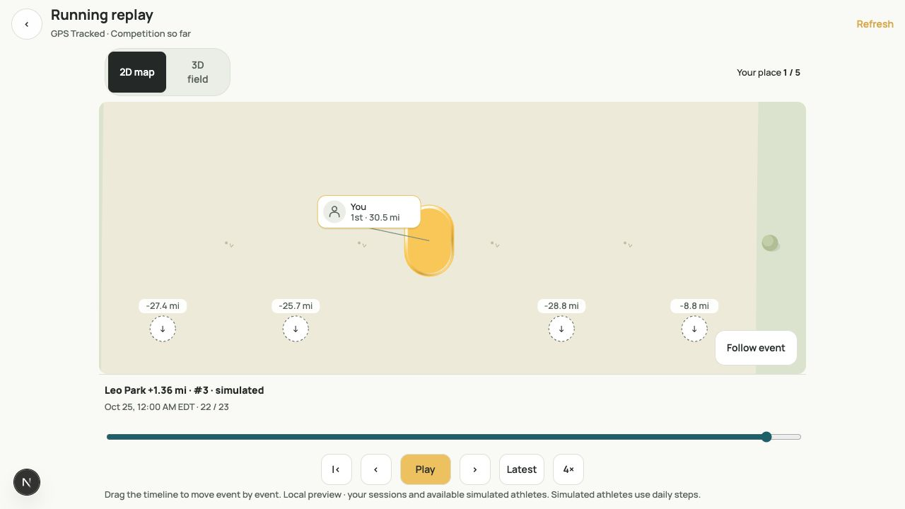
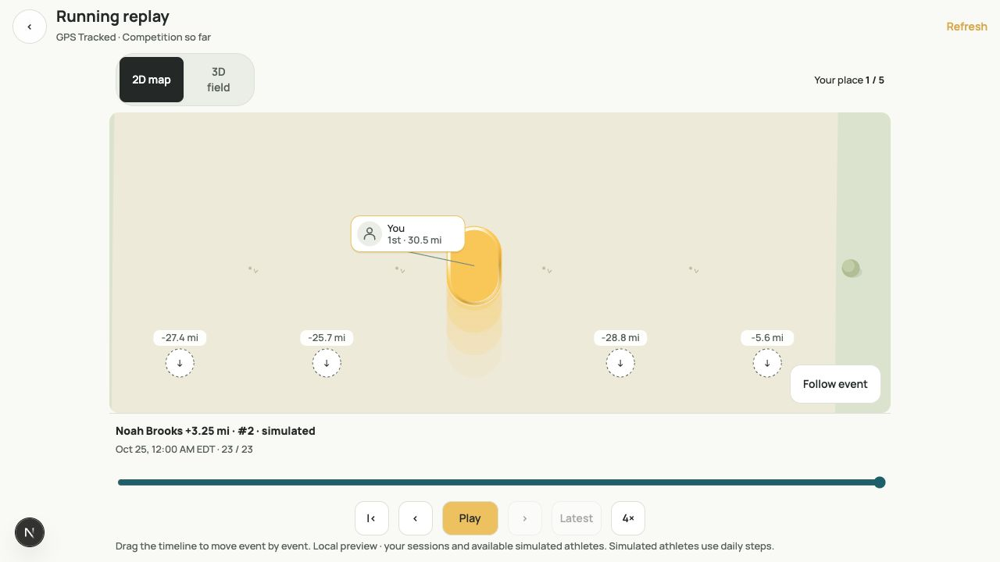

# 2D field performance — October 25

The production 2D field on web and native now shows capsule heads with short,
independently animated local echoes and without accumulated-distance ribbons. Ground choices, lane identities, distance
projection, offscreen indicators, athlete selection, ghost and standings remain.
The brand artwork and design studies retain their wake treatments.

## Findings

The selected “3D field” is the lightweight SVG `PortraitField`, not the older
Three.js pursuit. It has no idle animation clock, bounds the visible scene, and
coalesces gesture publications through requestAnimationFrame.

The 2D field did substantially more work:

- Fullscreen web and fullscreen/exploring native ran a wake clock publishing React
  state at about 30 Hz, even when no athlete or camera was moving. This rerendered
  the field and every capsule, including offscreen lanes. Inline wakes were still
  painted, although the clock was disabled there.
- Each capsule wake used four echoes, two SVG masks, a fade gradient and clipping.
- `fieldCourseScene` rebuilt per-athlete earned ribbons and a full-field head-clear
  mask on lane/replay updates. Each non-oval ribbon sampled 81 points on each side;
  the oval constructed 24 gradient segments per athlete. Large scrollable SVG
  surfaces made the mask/compositing cost especially undesirable.
- Web replay already interpolated values every animation frame, but a marker whose
  camera was stationary could restart a 480 ms Motion transition every frame.
  Repeated easing could visibly trail the supplied replay position.
- 2D pan/pinch handlers published every input event, rather than batching movement
  once per animation frame.

These are code-established sources of excess work. No on-device profiler capture
was available to assign a percentage of the observed lag to each one.

## Changes

- Remove both legacy trail systems from production 2D; replace only the short
  echoes with isolated native/browser animation (see below).
- Omit wake-only SVG definitions when rendering capsule heads. Memoize capsules so
  camera/athlete position changes do not rebuild unchanged head art.
- Make ground paint independent of athlete values; reuse it when only values move.
  Camera/size/appearance/lane-count changes still regenerate scenery.
- Use ordinary SVG transforms for web replay markers; replay owns interpolation.
  Ordinary lane/standings transitions retain their existing animation behavior.
- Batch native pan/pinch and web longitudinal dragging to one pending frame,
  preserving the final position on release and cancelling work on teardown.

## Measurement

Run from this repository:

```sh
node scripts/benchmark-2d-field.cjs 07899d65
```

The script compares the old and new pure scene constructors over changing camera
centers, with 12 athletes, a 390 × 750 viewport, 1.2 km span and club surroundings.
It includes course construction, and excludes React, native bridge, layout, SVG
rasterization and compositing. Timings depend on machine load; this is not an FPS
measurement or a claim of equivalent end-to-end speedup.

Initial 2,000-frame run on the development machine:

| Ground | Before CPU | After CPU | Scene nodes before → after | Serialized scene bytes before → after |
| --- | ---: | ---: | ---: | ---: |
| Trail (default) | 14,375 ms | 716 ms | 142 → 90 | 33,568 → 12,357 |
| Oval | 22,447 ms | 31 ms | 1,396 → 49 | 183,833 → 5,695 |

The committed script defaults to 400 frames for a shorter repeat. Independently
of those timings, the production idle wake clock drops from about 30 React state
updates/second to zero. With a stationary camera, athlete-only replay updates no
longer invoke the scenery constructor at all.

## Validation

Regression coverage checks idle frame scheduling, scenery reuse, direct replay
coordinates, batched movement, final release/termination, capsule visibility at
field edges, all nine grounds, finite geometry and unchanged head artwork.

For release, compare 2D and 3D on a physical phone during replay at 1×/4×, timeline
scrubbing, vertical exploration, horizontal scrolling, pinch zoom and athlete
selection in inline/fullscreen modes. Device FPS remains to be measured.

Local checks passed: workspace typecheck; 312 web tests (5 skipped), 144 native
tests, 411 shared tests, and the production web build. The shared rerun used
`--maxWorkers=2 --testTimeout=30000` after the default parallel run hit an unrelated
mascot animation test timeout. Targeted web tests passed again after the final
direct-transform change.

The local browser walkthrough verified fullscreen 2D, 1×/2×/4× event replay,
previous-event stepping, Follow me/event, and switching 2D → 3D → 2D. The screenshot
shows the local preview ledger, with simulated-athlete disclosure retained.




## Original wake restoration with isolated animation

The first restoration used smaller rounded echoes. That variant is superseded:
the owner requested preserving the original appearance and animation. Production
now renders the original `polishedCapsuleScene` echo paths and mask definitions,
with four full-size capsules, original colors/stroke/fill opacity, original
head-clear/fade masks, original quarter-cycle offsets and original gold/platinum
cycle durations (1.15/1.32 seconds). Inline and reduced-motion views retain the
original still poses. Fullscreen/exploration animates. Start-line clipping is
restored too. The long accumulated-distance ribbons remain removed.

Only animation ownership changes. Web animates the original echo groups using
CSS transform/opacity, without React state ticks. A viewport-root
IntersectionObserver and visibility events pause hidden wakes; CSS pauses fields
covered by a modal. Native uses Reanimated animated props inside a separate,
bounded wake-only SVG per visible capsule. Its original masks invalidate only that
small SVG instead of the entire field. App background, screen focus, reduced
motion and fullscreen/exploration state control animation; still art remains.
Horizontal lane visibility and field activity bound mounted native wakes.
The implementation uses the existing
[Reanimated animated-props API](https://docs.swmansion.com/react-native-reanimated/docs/core/useAnimatedProps/).

Fidelity tests rasterize the original renderer and the independent renderer in
still mode, comparing RGBA buffers exactly for both colors with and without
start-line clipping. Native animation tests compare every echo's transform and
opacity against `polishedEchoPose` at multiple cycle phases for both colors.
Lifecycle tests retain the no-React-frame-commits and visibility cleanup checks.

The pure scenery benchmark above excludes wake animation and compositing cost;
it must not be interpreted as a measured end-to-end speedup with wakes enabled.
Physical-device frame rates remain unmeasured.


Browser validation confirmed the original capsule path, two wake masks and 1.15 s
gold cycle in the active replay. Web's 315 tests pass (5 skipped), native's 148
tests pass, and 14 shared field/capsule regressions pass. Workspace typecheck
passes. Camera movement also has a regression check that the native wake art and
its running animation stay mounted without restarting.


