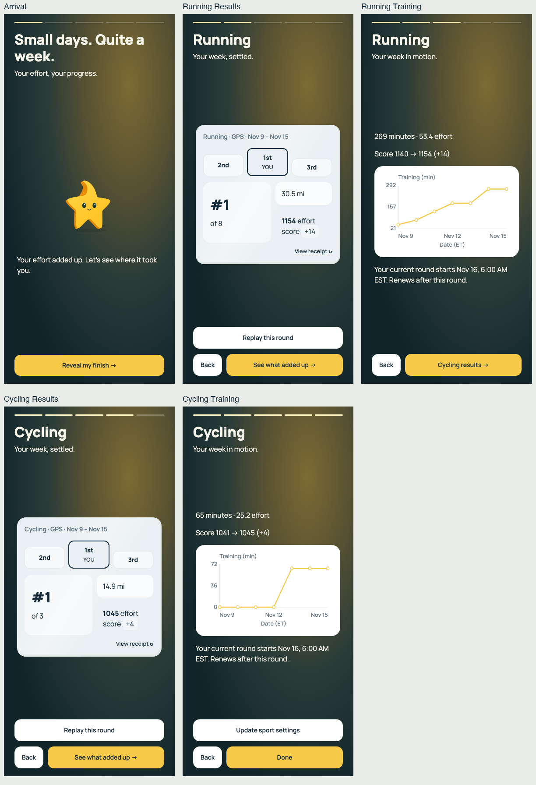

# Afterglow week recap

## Paired sport pages — current

Opening → Running result → Running training → Cycling result → Cycling training.
Both platforms build the same ordered page list. Primary pages fit the viewport;
replay and field choices open focused details. Larger text uses readable scrolling.

| Page | 390 × 844 | 320 × 568 |
| --- | --- | --- |
| Opening | [Screenshot](paired-arrival.png) | [Screenshot](paired-small-arrival.png) |
| Running result | [Screenshot](paired-running-results.png) | [Screenshot](paired-small-running-results.png) |
| Running training | [Screenshot](paired-running-training.png) | [Screenshot](paired-small-running-training.png) |
| Cycling result | [Screenshot](paired-cycling-results.png) | [Screenshot](paired-small-cycling-results.png) |
| Cycling training | [Screenshot](paired-cycling-training.png) | [Screenshot](paired-small-cycling-training.png) |

See [code review, simplification and validation](review.md).
