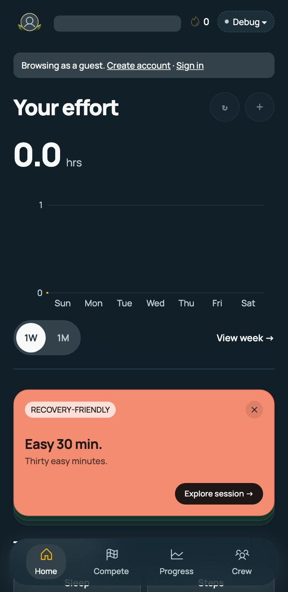
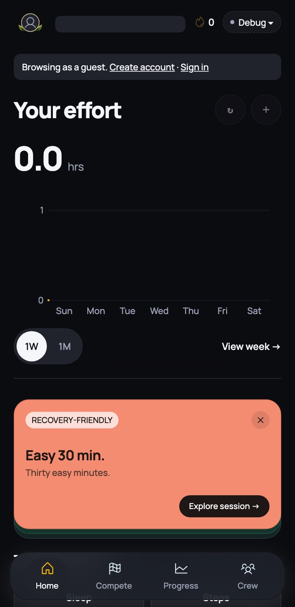
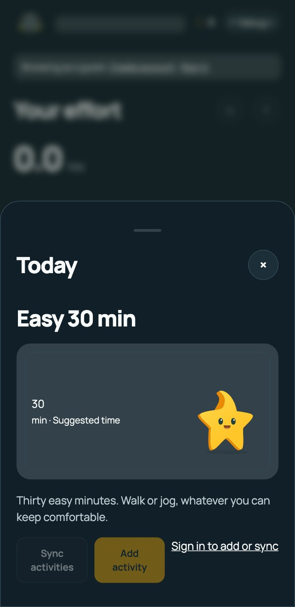
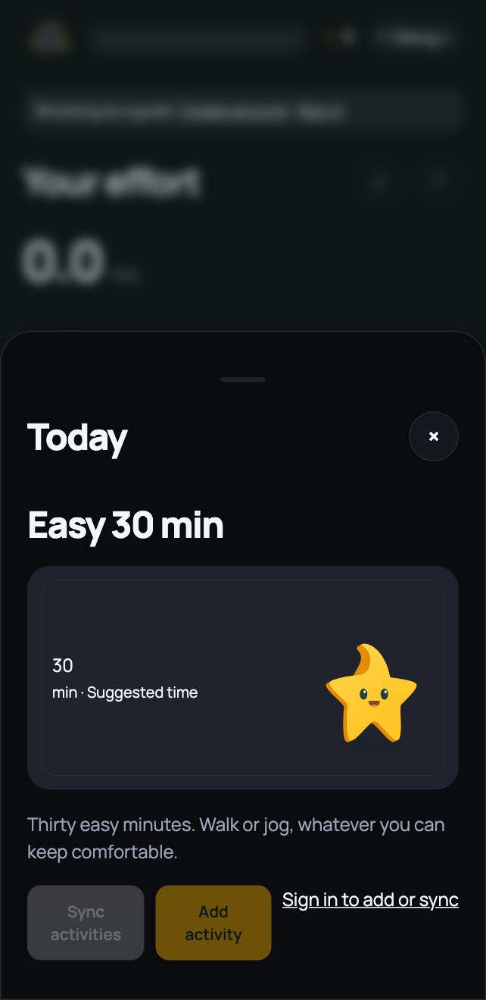
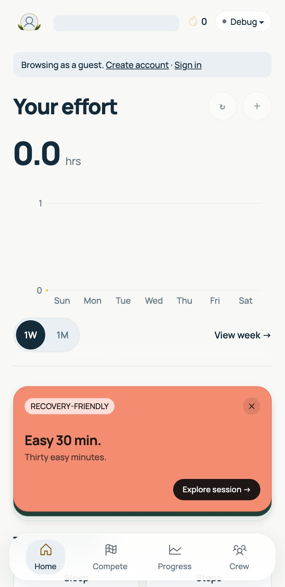
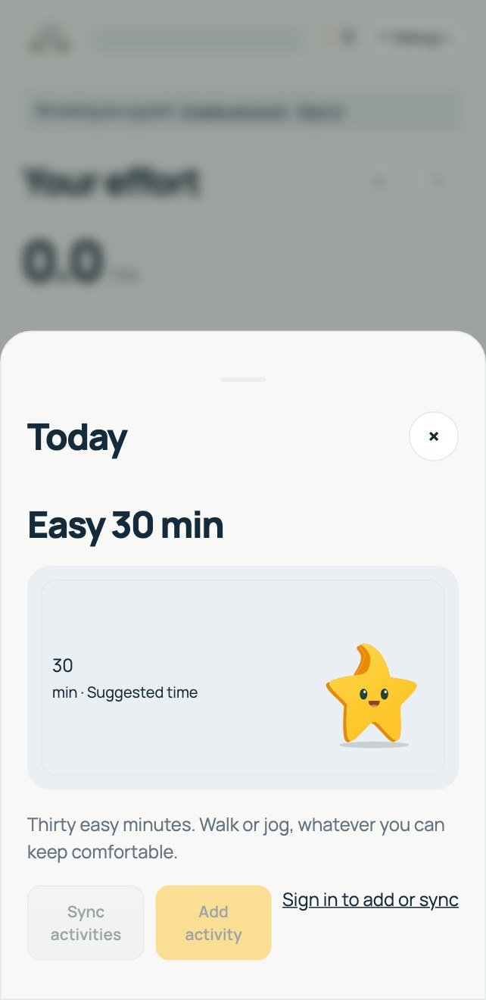
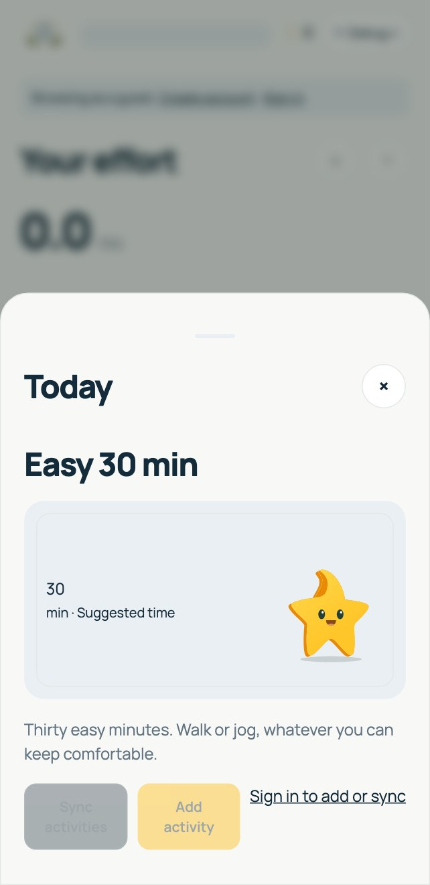

# Overtaek brand palette preview

These mobile-width website previews compare the prior Slate palette with Polished Silver and Whisper-Cool Obsidian. The same screens and guest state appear on both sides. The baseline restores the prior palette and the relevant control styles on the same build. Both sides show Medal Gold in sRGB. Workout is the Today session sheet, opened from the Home recommendation.

| Screen | Prior palette | Final palette |
| --- | --- | --- |
| Home, dark |  |  |
| Workout, dark |  |  |
| Home, light |  |  |
| Workout, light |  |  |

## Roles and contrast

- Medal Gold uses the existing Display P3 and sRGB paths. Action ink has 8.42:1 contrast against the sRGB gold.
- Polished Silver uses the specified sRGB values on all displays. It supplies supporting icons, focus rings and outlined controls. Comparison Silver remains a distinct chart role.
- In dark mode, canvas is `#0B0C10`, cards are `#15171D`, and navigation and elevated controls are `#20232C`. Dark secondary text is `#9BA3B4`. The quieter `#666E80` token is available for decorative use.
- Light Comparison Silver has 3.65:1 contrast on the canvas and 3.86:1 on white. Light Polished Silver has 5.48:1 on white. Text labels and chart marks have distinct roles.
- The recovery recommendation title uses the ink associated with the card, including in dark mode.

## Remaining review

Review navigation and sheet contrast on physical devices, particularly with native blur enabled. Map overlays and WebViews retain their renderer-specific treatments. Podium metal colors, rank and mascot artwork, route and recommendation categories, warning amber and historical design studies retain their own palettes. These are remaining uses of older gold, silver and blue-gray values. There is no dedicated Chrome Silver wide-gamut override in the production appearance palette.
