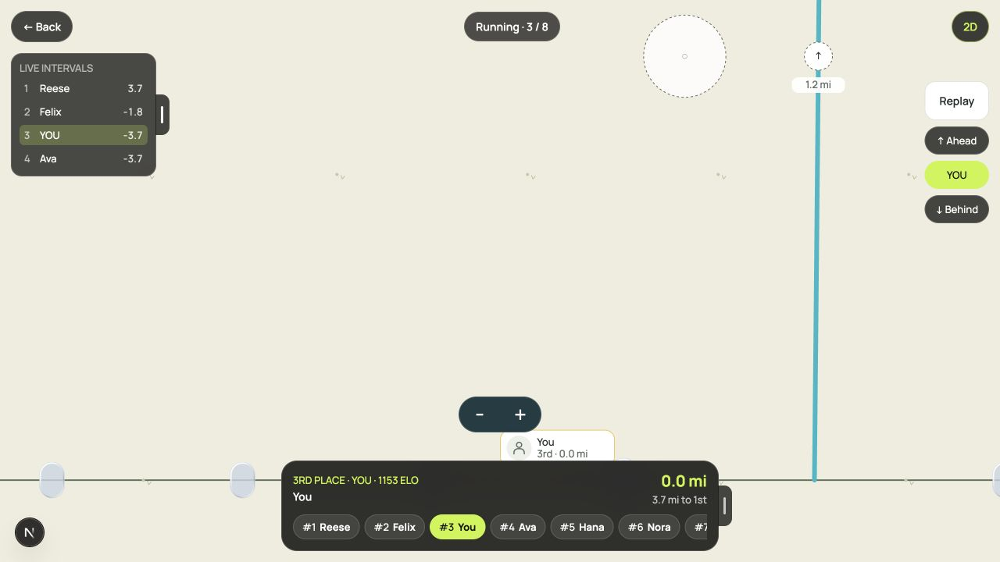
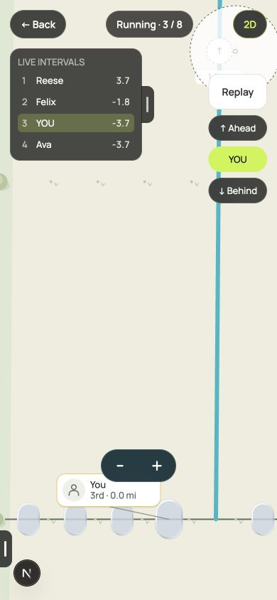
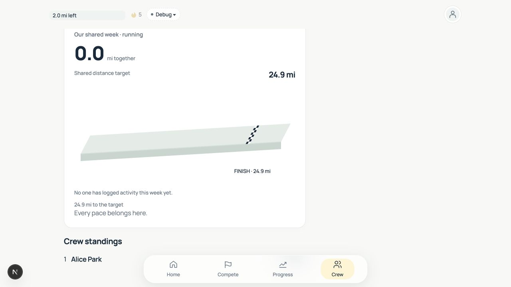

# Side grips and overlay motion

The follow-up removes Crew finish flags and preserves only the checks printed in
the block's top plane. Fullscreen panels keep their expanded bounds and slide
left over 320 ms, leaving an 18 px sheet-style side grip. The grip has a 44 px
interactive area. Panel content stays mounted and becomes inaccessible while
collapsed; toggling mid-slide reverses from the displayed position.

Holding fades chrome out over 160 ms and releasing fades it back in. Hit targets
are disabled immediately while hidden. Native View overlays use the native
animation driver; SVG label groups use Animated props without React frame
updates. Reduced Motion disables both fades and slides.

Browser verification used the actual Compete and Crew routes at desktop and
390 px phone width. The bottom panel retained its 302 px width when collapsed
and ended at the left edge. During expansion the browser reported an intermediate
translation of -395 px (rather than jumping from -920 px to zero). Immediately
after hold release, HUD opacity was 0.10 with a 0.16 s transition, confirming the
fade back in. Panels reopened independently and Crew displayed no flags.

Validation: workspace typecheck, UI typography lint, shared finish-scene tests,
native motion/interaction tests, web field/gesture tests, and production web build.
Native animations still need a physical iOS/Android smoke test.
