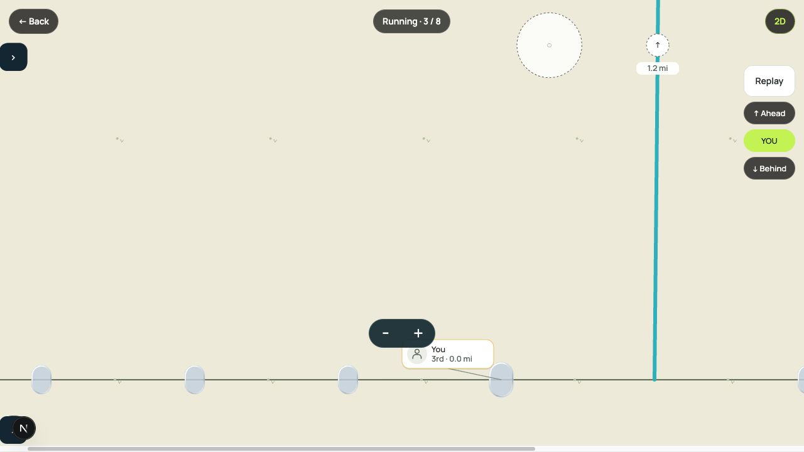
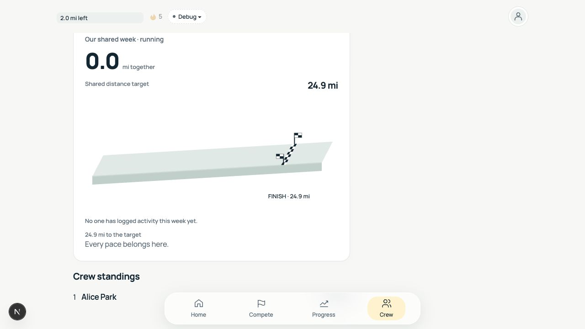

# Compete overlays and Crew finish

October 26, 2026.

Offscreen distance labels now measure the unsigned distance between the athlete
and the nearest longitudinal viewport edge. Pan and zoom update the gap. The
capsule center is the boundary: at zero, the arrow disappears and the capsule
returns. Visible athlete nameplates retain their relative-to-you values.

Fullscreen Live intervals and the bottom athlete panel collapse independently
into left-side tabs. A stationary 450 ms hold temporarily hides field overlays;
release or cancellation restores them. Moving at least 4 px or adding a second
finger cancels a pending hold. Releasing a hold does not select an athlete.

Crew finish checks use the progress block's top-plane projection instead of its
front face. Flags stand at both ends. The existing target position and totals
remain unchanged.

## Browser review

Verified the production web Compete route using its local preview roster:
fullscreen expansion, both panels collapsing independently, interval expansion,
return to inline view, and the Crew finish rendering.

## Validation

- Workspace typecheck.
- Shared viewport, perspective, finish-scene and hold tests.
- Web gesture, field, pointer-event lifecycle and Crew tests.
- Native field, gesture and fullscreen integration tests.
- Production web build.

Native behavior was checked by typecheck and automated gesture tests; no physical
iOS or Android device was used in this pass.

## Review fixes

The review against current `origin/main` found and fixed these interaction gaps:

- A 4–8 px drag could start panning while leaving the hold timer pending. Hold
  cancellation now matches the field's four-pixel gesture threshold.
- Native zoom/replay touches bubbled into the scene hold observer. Those controls
  now stop the scene touch-start event.
- A delayed synthetic press could outlive the original 100 ms tap-suppression
  window. A consumed hold now stays consumed until the next gesture, with native
  HUD actions remaining independent and keyboard web activation preserved.
- Lost pointer capture, browser backgrounding and native app interruptions now
  clear pending/active holds, so overlays cannot remain hidden after interruption.
- Hidden native offscreen arrows no longer leave invisible focus targets behind.

The web event binding is isolated from the persistent portal host, allowing tests
of actual listener registration, release consumption and cleanup. Native component
integration tests cover hold/selection, app interruption, control isolation and
independent panel toggles. Lane projection is computed once per rendered athlete.
