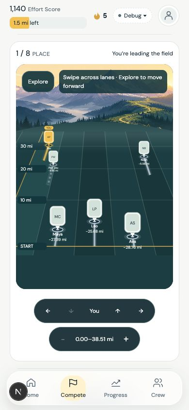
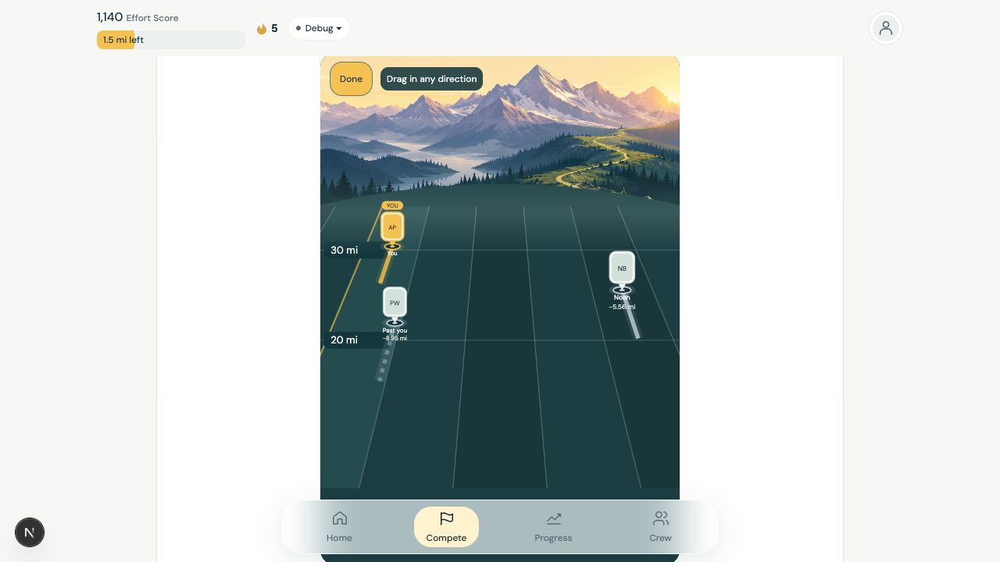

# Distance-plane competition field

The previous portrait field squeezed distances into a narrow visual band and
placed offscreen athletes at the same apparent depth. It only browsed lanes.
This revision uses a perspective distance plane on web and native, retaining the
selected alpine field and its SVG implementation.

- Actual values determine longitudinal placement. The projection uses
  `perspective = 1 / (2 - depth)` with depth derived from the shared window;
  ground survey lines, portrait anchors, and gesture inversion use the same map.
- Independent lateral focus preserves stable identity lanes. Explicit Explore
  enables two-axis dragging; native fullscreen is always explorable. Ordinary
  page scrolling remains available outside Explore. Web supports keyboard
  navigation and wheel/trackpad panning in Explore.
- Start and accumulated-distance ticks, actual relative gaps, offscreen athlete
  shortcuts, zoom, and return-to-you controls make distant positions reachable.
  Ghosts use their actual coordinate and never enter place or field size.
- Only nearby lane geometry and in-window portraits are painted. Updates are
  event-driven and coalesced per animation frame, with pending frames cleaned up
  on unmount. There is no idle animation or additional rendering dependency.
- Existing parent-owned distance/zoom state and native fullscreen horizontal
  anchor are retained. Fullscreen reserves space for the attached controls.

No scoring, period, SQL, tracker or backend writes change. No migration or new
native dependency is required. The earlier Three.js scene remains independent;
this selected renderer does not require the web scene deployment on native.

## Local validation

- Next dev runtime compiled and served Compete with the revised field.
- Browser review at desktop and 390×844 phone size: selected 3D; zoomed the
  distance window; navigated to an offscreen rival at its real total; returned
  to you; and dragged diagonally, moving both lane focus and distance bounds.
  Keyboard and wheel panning changed the labeled bounds; browser error/warning
  logs were empty during the final review.
- iOS Hermes export completed successfully. Native simulator runtime inspection
  found the installed binary uses React Native 0.86.3 while this checkout's JS
  uses 0.88.0 (and its Worklets native module lacks the expected API), preventing
  a native tap-through. A matching rebuilt development binary is still needed
  for native gesture/FPS verification. No device FPS claim is made.
- Regression fixtures were updated for offscreen culling, shared survey/marker
  projection, and the new pan callback. Type checks and test suites were not run,
  as requested. The installed Next 15.5.27 package does not contain the
  `dist/docs` directory referenced by AGENTS.md; no Next APIs were introduced.

Screenshots preserve local preview data only. No deployment or merge was run.

