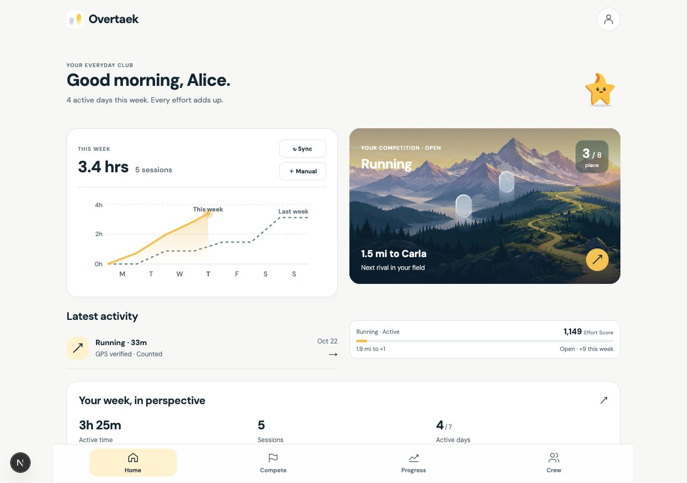
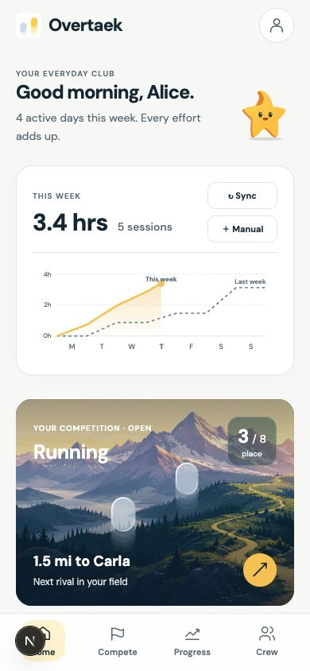
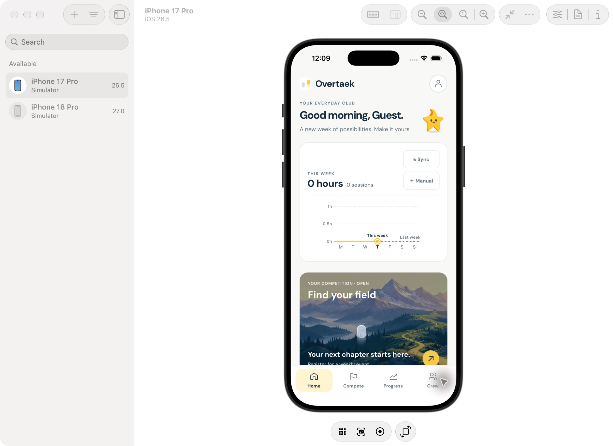

# Everyday Club rollout — October 22, 2026

The owner selected the supplied Everyday Club reference and authorized the complete web/native implementation. The stack retains yellow/Ember, 2D default competition, manual/imported activity without a recording flow, and Crew without a social feed.

## Stack (merge from bottom to top)

| PR | Slice | Base |
| --- | --- | --- |
| [261](https://github.com/jerryliu3/fitness-battle/pull/261) | Semantic visual system and component rules | main |
| [262](https://github.com/jerryliu3/fitness-battle/pull/262) | Navigation and reusable controls | 261 |
| [263](https://github.com/jerryliu3/fitness-battle/pull/263) | Personal Home overview | 262 |
| [264](https://github.com/jerryliu3/fitness-battle/pull/264) | Illustrated next-rival preview | 263 |
| [265](https://github.com/jerryliu3/fitness-battle/pull/265) | Weekly recap and settled result preview | 264 |
| [266](https://github.com/jerryliu3/fitness-battle/pull/266) | Event carousel and chooser | 265 |
| [267](https://github.com/jerryliu3/fitness-battle/pull/267) | Immersive map and optional alpine 3D | 266 |
| [268](https://github.com/jerryliu3/fitness-battle/pull/268) | Progress views and timeframes | 267 |
| [269](https://github.com/jerryliu3/fitness-battle/pull/269) | Session and effort achievements | 268 |
| [270](https://github.com/jerryliu3/fitness-battle/pull/270) | Latest activity and activity detail | 269 |
| [271](https://github.com/jerryliu3/fitness-battle/pull/271) | Crew identity and shared week | 270 |
| Final polish | Token migration, secondary flows, accessibility and review evidence | 271 |
| Native compatibility | Locked dependency patches required by the local iOS build | Final polish |

The tip contains the complete redesign. Each PR is based on the preceding branch; none are merged automatically.

## Verification

- `pnpm typecheck`: passes across all workspaces.
- `pnpm test`: 685 passed, five existing skips; includes Eastern DST boundaries, future/excluded/sample activity, rival selection, pace units, achievements, viewport/bridge behavior and native registration/field retention.
- `pnpm --filter @fitness-battle/web build`: passes, including all 71 static pages.
- `expo export --platform ios`: passes with the new native screens, illustration and icon assets.
- Rendered Expo web at 390px: Home, Compete, Progress and Crew inspected; chooser → register Cycling → selected Cycling field verified; prior week changes Oct 19–25 to Oct 12–18; synthetic-athlete and account-required disclosures remain visible.
- Expo web screenshots are explicitly labeled `expo-*`. Actual iPhone 17 Pro / iOS 26.5 rendering is saved as `ios-home.jpg` and `ios-progress.jpg`. Native Home and Progress were inspected through Device Hub; Previous week changes the displayed dates correctly. The local simulator build completes with zero compiler errors/warnings after the two compatibility patches.
- Web Home inspected at 320px, 390px and 1280px; intrinsic chart overflow fixed. Activity sheet focuses its heading, exposes Close, and returns focus to the latest-activity opener.
- No production migration, live tracker sync, account modification, deployment or merge was performed.

## Design decisions and remaining validation

The selected system is Everyday Club: navy typography, neutral canvas, yellow actions, teal charts, alpine scenery, compact controls and recognizable capsule racers. Overview data precedes longer histories. Decorative landscapes never represent GPS locations. Session metrics do not invent a route or split data. Previous-week charts plot only available dated activity; archived totals cannot reconstruct a daily trend.

Basic achievements are read-only snapshots of available counted sessions and the primary sport's Open rating. They can change when activity is excluded; they do not create permanent reward entitlements. On-device haptics, live HealthKit reads, Android hardware rendering and production OAuth still require their normal device/service checks. Navigation and focus are exercised locally; no usability-study claim is made.

See [UI audit](../../design/ui-audit.md), [component rules](../../design/component-guidelines.md) and [illustration provenance](../../design/illustration-assets.md).

## Screen evidence

