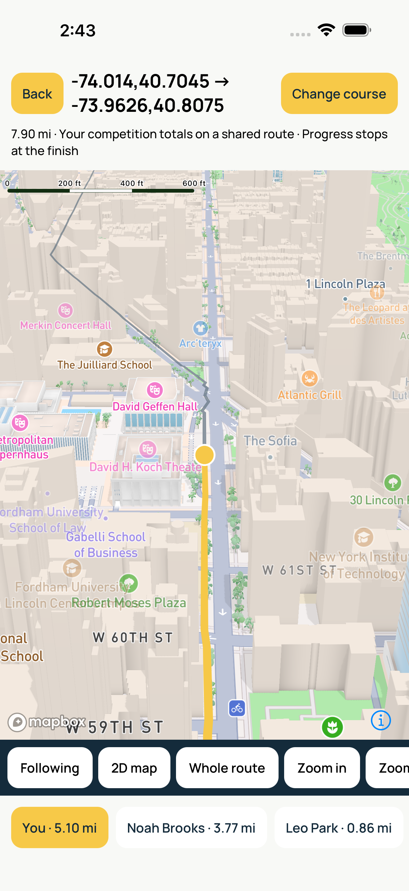
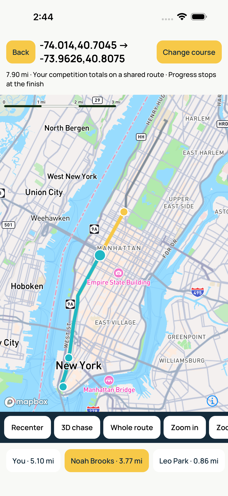
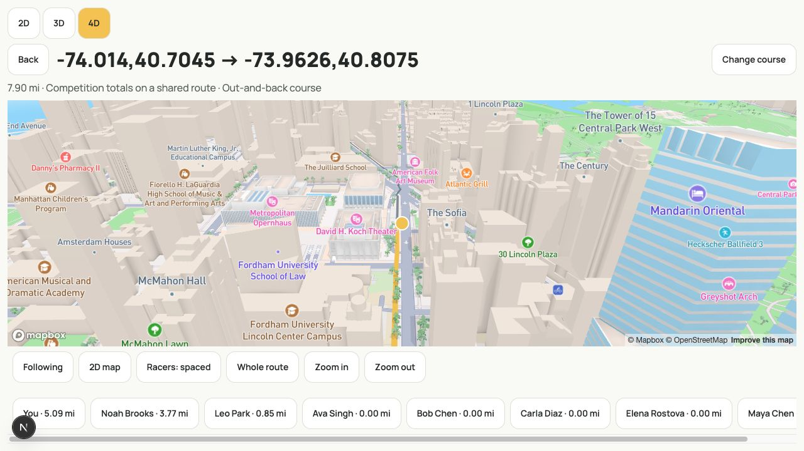
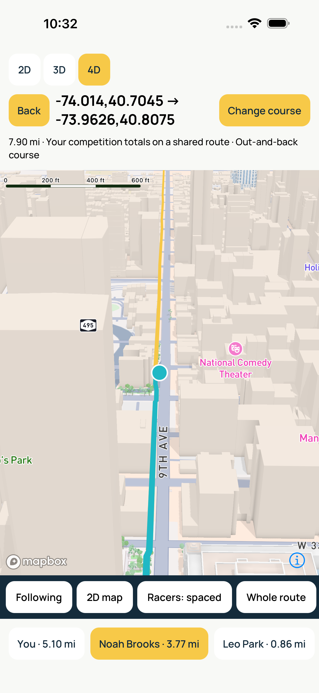
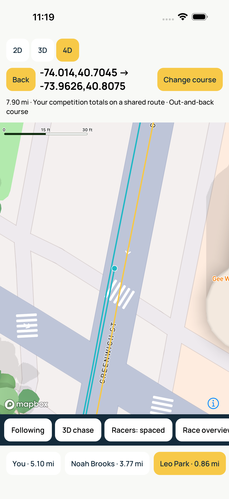
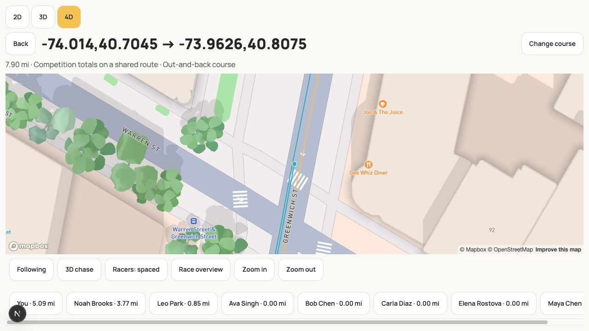
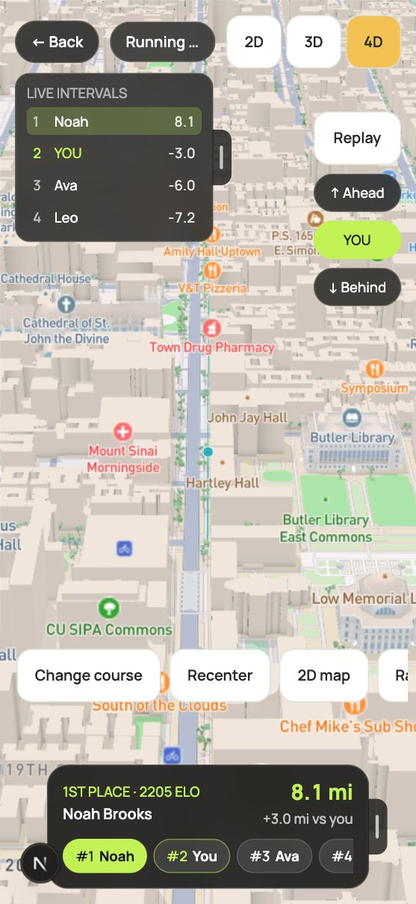
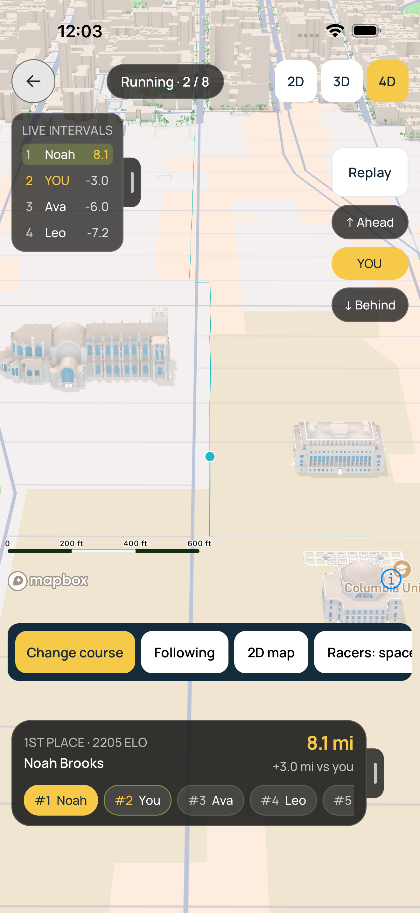
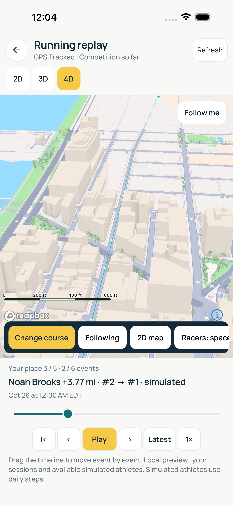

# Geographic course navigation

A course is presentation geometry, separate from activity ingestion and scoring.
GPX imports do not record workouts or change competition totals. One continuous
GPX track segment or route is accepted; disconnected tracks are rejected rather
than connected with an invented straight line. Input is bounded to 4 MB and
20,000 points. Native/web share a cumulative metre index with logarithmic seeks.

Distance fields convert km/mi to metres and place athletes along the same route.
Points-based fields retain the existing visualization. Athletes retrace the route back and forth at each endpoint; cumulative
distance and standings continue unchanged. The chase camera faces the direction
of travel. After the first outbound trip the complete covered trail stays visible,
with geometry bounded independently of subsequent trips. Course selection is local
to the current view, not a server-authoritative assignment to other participants.
Shared published course assignment is a separate product/data change.

The field selector exposes **2D / 3D / 4D** inside one field host, inline and
fullscreen. Changing modes preserves fullscreen, shared athlete selection, panel
collapse state and the chosen course. Unmounting the chooser cancels pending
requests. Points fields only expose 2D/3D.

The underlying route stays invisible ahead of the field. Each athlete reveals
only their own covered trail, so the leading athlete discovers new ground first.
Zero activity draws a dot at the start but no trail. **Race overview** fits only
earned trails and current dots; it never frames the unreached route.

The viewer's own lane stays centered on the route. Peers alternate left/right in
stable ID order with 42 cm between adjacent lanes (ten lane centers span 3.78
metres). Selecting a peer moves the camera without rearranging lanes. **Racers:
spaced / Racers: together** permits comparison. Each dot and its individual trail
interpolate the same offset polyline, including bends and return legs, so the dot
always sits at its trail's endpoint. Offset vertices are computed lazily and
cached; selection reuses the trail source instead of resending all geometry.

Trails are thin opaque lines: approximately 36 cm near the course's origin when
zoomed in, with a 1.25 px visibility floor when zoomed out. This is illustrative
spacing rather than road-width queries or collision simulation. Narrow roads and
zoomed-out marker overlap remain possible. After a racer covers the whole course,
a full traversal plus the current partial leg keeps all covered ground visible
and the line ending at the dot. Geometry is bounded to two traversals regardless
of total laps.
The geographic view uses one platform-agnostic camera controller. Focus resumes
following; direct manipulation, zoom and overview suspend it. Two-dimensional
and chase views use the same map instance. The map engines execute gestures,
inertia and camera animations; React does not drive the camera every frame.
Reduced Motion makes programmatic transitions immediate.

Follow-up implementation layers:
1. Shared GPX/course index and camera contract.
2. Native Mapbox and web Mapbox GL adapters; GPX and Directions route chooser.
3. Physical-device and native-build validation, with limitations recorded below.

Mapbox Standard supplies scenery. We do not add or maintain a custom city asset
library, or add Skia in parallel. Mapbox credentials come through existing env
modules, and attribution remains visible. Map styles/tile availability depend on
Mapbox service access. Route generation uses explicit waypoint coordinates and
a walking/cycling profile; choosing only a city is not sufficient to invent a
safe or meaningful race course. No live GPS permission is required.

## Native/web integration

Compete exposes **4D** beside **2D / 3D** for km/mi fields, using the same
inline/fullscreen host, roster, selection and broadcast HUD. Import GPX or
submit start/destination addresses, city names or `longitude,latitude` pairs.
Mapbox Geocoding resolves text on explicit submission; Directions requests a
walking or cycling route. Inspect the returned route: the first place-search
match is used, and a city name alone is not a detailed itinerary. Requests abort
on close/unmount or replacement. Course files stay local and are never sent to
activity ingestion. Course choice currently lasts for the mounted competition;
it is not persisted or published to peers.

The native renderer uses `@rnmapbox/maps` 10.3.12 with the Expo config plugin;
its default iOS pods resolve Mapbox Maps 11.33.0. Native pan, pinch, inertia and
camera interpolation execute in Mapbox, not a React RAF loop. Camera callbacks
only retain the observed pose; React updates once when a gesture suspends follow.
A gesture must never trigger a corrective `setCamera` command: the native engine
already cancels its animation. Native and web adapters share the same camera
intent/controller and geographic geometry. Next defers its Mapbox GL chunk until
the course screen opens. Expo's static browser preview links to the Next web app
rather than bundling the iOS/Android Mapbox module.

Use **2D map / 3D chase** without replacing the map instance, **Race overview** to
inspect covered ground, **Recenter** to resume following, and zoom controls
as an alternative to pinch. Selecting an athlete again recenters it. All route
geometry is independent of the camera; every earned trail remains visible even
when its start is outside the viewport. Basemap and
Mapbox attribution remain visible. Imagery/scenery are supplied by Mapbox
Standard; no custom scene asset pipeline or second Skia renderer was added.

This is the new geographic view's UI-thread camera path. The shipped SVG fields
remain available and retain their existing implementation; they were not
silently replaced or rewritten into Reanimated. Shared published event-course
assignment and game-style animated runner models are not part of these PRs.

## Run locally

Use public Mapbox tokens that permit your test environments:

- Native: `EXPO_PUBLIC_MAPBOX_ACCESS_TOKEN` in `apps/mobile/.env.local`.
- Next: `NEXT_PUBLIC_MAPBOX_ACCESS_TOKEN` in `apps/web/.env.local`.

Do not put private/download tokens in these variables. API requests are made
only when the chooser is submitted; map usage and place/Directions requests use
Mapbox services and their configured account. Place-search results here are
transient, not saved as a persistent geocoding database.

```sh
pnpm install --frozen-lockfile
pnpm --filter @fitness-battle/web dev
# Rebuild native; an OTA bundle or Metro alone cannot add the Mapbox module.
EXPO_PUBLIC_API_URL=https://fitness-battle-one.vercel.app pnpm --filter @fitness-battle/mobile exec expo run:ios --device --configuration Release
```

For simulator development, use `expo run:ios` without `--device` and select the
intended simulator. Android requires the corresponding native rebuild. Existing
SDK 58 / RN 0.88 prerequisites and signing requirements still apply. Generated
iOS/Android projects remain generated artifacts; commit config/plugin/dependency
changes, not a copied native binary.

## Validation

Shared regressions cover GPX routes/tracks without timestamps, rejected
multi-segment tracks, duplicate/invalid geometry, metre indexing, date-line
interpolation, unit conversion, selected trail endpoints, follow interruption
and reduced motion. Adapter regressions verify stable map ownership, gesture
suspension of follow, resumed selection from the observed pose and athlete taps.
These mock the platform map drivers; they do not establish real-map frame rate.

Real-map QA uses local public Mapbox tokens configured in ignored environment
files. The owner supplied the token during implementation; it is not committed.
The iOS Release build with native Mapbox succeeded. Actual browser and simulator
walkthrough evidence is summarized below. For a physical-device check, exercise: GPX import; API route generation; near/far/repeated selection; interrupted
flight; two-finger pinch followed by one-finger dragging; live updates while
exploring; 2D/chase/overview; reduced motion; close/reopen; long efforts and repeated turnarounds.
Measure sustained physical-device performance separately from simulator input.

The field host owns selection for every mode. In 4D, selection only commands
the geographic camera; it does not start a hidden SVG camera animation. Both adapters render only athlete dots and individual earned trails. Unreached
course geometry is not supplied to any map source. Geometry is cached by course,
immutable roster, spacing and viewer anchor; selecting a peer changes dots and
the camera without rebuilding or retransmitting the trail collection. Offset
vertices are cached lazily only as needed. All update work remains independent
of camera frames. These invariants are covered by adapter regressions.


### Initial runtime evidence (before individual trails)

- Browser: real Mapbox Standard buildings/scenery loaded; city-name geocoding
  generated a New York → Brooklyn walking route. Explicit Manhattan coordinates
  generated a 7.90 mi route after ferry exclusion. Imported a GPX fixture through
  the file chooser. Athlete selection showed intermediate then final camera
  coordinates, 2D/chase controls worked, keyboard panning suspended follow, and
  SDK fitBounds framed the whole route. A phone viewport was checked and the
  temporary override reset. A browser screenshot is in `images/`.
- iOS: built native Mapbox 11.33.0 / React Native 0.88 in Release for arm64, then
  refreshed the final Hermes bundle in that native binary. Installed on iPhone
  17 Pro Max / iOS 26.5 without resetting account data. The native walkthrough
  requests the real Manhattan route and uses actual XCTest touch gestures.
- Initial runtime QA caught ferry routing and an overly wide hand-calculated
  overview. Directions now excludes ferries; both renderers use the SDK's own
  padded route bounds. A first test failed because it tried to switch to 2D
  after Whole route had already switched there; the corrected test respects
  that state transition.
- No physical-device FPS, heat or battery comparison has been measured. Native
  GPX file-picker interaction is not part of the simulator walkthrough; GPX
  parsing and the actual browser file-picker path are covered separately.

Reproduce the simulator walkthrough (requires the installed Release app and its
existing seeded Alice/Noah competition):

```sh
GEM_HOME=/opt/homebrew/Cellar/cocoapods/1.17.0_1/libexec /opt/homebrew/opt/ruby/bin/ruby docs/reviews/geographic-course/native/create-runner.rb /tmp/course-native-ui-review
xcodebuild test -project /tmp/course-native-ui-review/FieldGestures.xcodeproj -scheme FieldGestures -destination 'platform=iOS Simulator,name=iPhone 17 Pro Max' -derivedDataPath /tmp/course-native-ui-review/build -parallel-testing-enabled NO -collect-test-diagnostics never CODE_SIGNING_ALLOWED=NO
```

The test's map-frame discovery is specific to the documented portrait simulator
layout. The first case launches the app afresh, chooses a route, and the second
continues that state to test both views. It performs no activity or score writes.

The final native walkthrough passes both cases (80.0 seconds): a real route
request and repeated diagonal drags, both pinch directions, peer selection and
whole-route controls in 3D and 2D. Pinch screenshots visibly change the map
scale (for example, the 3D ruler changes between 600 ft and 1,000 ft).
19 focused shared/native/web regressions, workspace typechecks, UI contract,
web production build and the native Release build pass.






### Earlier third-view and marker-spacing validation

The **4D** selector replaces the separate course-entry button on native and web.
The native modal owns a SafeAreaProvider so its view controls remain below the
iOS status bar. Switching out of 4D cancels pending loading, preserves the chosen
course, and stops the hidden portrait renderer. Spacing changes only marker
geometry and camera targets in that earlier version; the individual-trail design
above supersedes its shared-centerline presentation.

The follow-up has 15 shared regressions, two native adapter/selector checks, and
three web adapter/selector checks. They cover tied racers, rank reorder, bends,
return trips, zero-spacing comparison, actual displayed camera targets, and
points-field view availability. The web walkthrough loads a real Manhattan route,
compares spacing, and switches 4D → 3D → 4D with the course retained.




The final iOS simulator run passes all three XCTest cases (155 seconds): real
course loading, repeated pan/pinch and peer selection, and spaced/together plus
2D/3D/4D transitions. This includes fullscreen 2D → 4D and returning to the same
course. Screenshot review caught a modal safe-area issue; adding the modal's
SafeAreaProvider fixes both control placement and touch targeting. The initial
switching run failed before that correction; the final run has zero failures.
The follow-up reused the compiled native Release app with refreshed JavaScript
in production mode, without bytecode optimization or minification for this local
interaction check. Native SDK compilation and physical-device performance were
not rerun for these JavaScript-only changes.




### Individual trail discovery follow-up

The shared model tests cover viewer centering, ten tightly packed lanes, no future
geometry, no trail at zero activity, discovered-only bounds, shared marker/trail
endpoints through bends/date-line crossings/return trips, and bounded geometry
across thousands of trips. Adapter checks verify that no full-course source is
created and that selecting a peer does not resend the trail collection.


All four actual iOS simulator scenarios pass for the individual-trail update
(120.6 seconds): route loading, pan/pinch/selection, view and spacing switches,
and a zoomed-in peer selected on its own trail. Browser inspection verifies
separate narrow trails and the discovered-only overview without style errors.
The maps cap zoom at 20 so a near-zero discovered area cannot overzoom past the
controls' supported range. No future-course source is created on either platform.






After setting consistent 0–20 zoom bounds, the native app's final JavaScript bundle was refreshed
and course loading plus the close-up trail scenario were rechecked (two cases,
zero failures, 31.4 seconds). The final 20 focused shared/native/web tests,
workspace typechecks, UI contract, and web production build pass. Device frame
rate/heat/battery remain unmeasured.


### Tighter road footprint

The spacing follow-up compresses lane centers from 1 m to 0.35 m apart, reducing
ten racers from a 9 m span to 3.15 m. Trail width drops from approximately 35 cm
to 12 cm at close zoom, retaining the 0.75 px visibility floor. Selected/peer dot
radii shrink from 10/7 px to 5/3 px with a 1 px outline. Both platforms consume
the same shared spacing/width constants; viewer centering and trail alignment
stay unchanged. This reduces sidewalk spillover without road-boundary queries.
The tighter layout trades some zoomed-out separation for a smaller footprint;
GPX routes still provide no road-width guarantee.


The compact layout passes the 16 shared course checks, both map-adapter checks,
and workspace typechecks. The iOS course-load and close-up scenarios pass again
(two cases, zero failures, 28.7 seconds), using the same road as the earlier
screenshots. The individual-trail screenshots above now show the tighter layout;
the visible racers stay on this road. Other narrow/off-center routes remain an
approximation, rather than a guarantee of road containment.


### Shared field overlays and competition replay — October 27

4D now renders inside the same field container as 2D/3D on native and Next.
Fullscreen uses the existing live intervals, ahead/you/behind jumps, selected
athlete spotlight, athlete chips, independently sliding panels and stationary
hold-to-hide interaction. The course chooser leaves only the top bar visible so
panels cannot cover its form. Map gestures retain ownership; holds only observe
input and ignore movement/multiple fingers. Native map controls fade with the
HUD; attribution stays available. Native scale/attribution ornaments sit above
the map toolbar and spotlight. Scene load warnings float without resizing the
map, distinguish partial scenery failures, and clear when loading becomes idle.

Competition replay offers 2D/3D/4D for distance events, including history entry
points. Opening from 4D inherits the chosen course and initial mode. Switching
modes preserves the timeline, selected athlete and course; choosing another
course in replay updates the mounted live field as well. All marker/trail values
come from the existing replay frame, including rewind to zero, event/me follow,
play/pause, event stepping, latest/finish and 1×/2×/4× playback. No future live
trail leaks into replay. 4D playback publishes at most ten GeoJSON updates per
second while Mapbox interpolates the camera; explicit seeks paint immediately.
This bounds bridge/source work but does not establish physical-device FPS.
The automatic sync/overtake receipt remains its existing dedicated 2D animation
(the same restriction already applies to 3D); this change covers the browsable
competition replay.

Validation on the final implementation:
- iPhone 17 Pro Max / iOS 26.5, existing Release native binary with refreshed JS:
  two XCTest walkthroughs passed in 69.7 seconds. Real Manhattan routing,
  sliding both panels, selecting a rival, drag/pinch, fullscreen mode switching,
  replay seek/back to start, mode switching inside replay, play/pause and return
  to the inline 4D field were exercised.
- Browser: actual Mapbox scenery, shared overlays/panel toggles, rival selection,
  fullscreen 2D→4D switching, replay latest/start/play, 2D/3D/4D replay switches;
  checked the shared HUD at a 390×844 phone breakpoint.
- Component regressions exercise shared host/selection/course/replay wiring on
  both platforms, plus replay backward seeking. Existing geometry and adapter
  regressions retain trail/dot alignment, no future route, gesture interruption
  and selection flights.
- Simulator validation reused the installed Mapbox module. No new native
  dependency or pod install is required for this follow-up. Physical-device
  heat/battery/FPS and native document-picker GPX import remain unmeasured.






The [racer-card and wider-trail follow-up](racer-callouts.md) adds the shared 2D
nameplate to geographic maps and supersedes the earlier 35 cm / 12 cm footprint.
