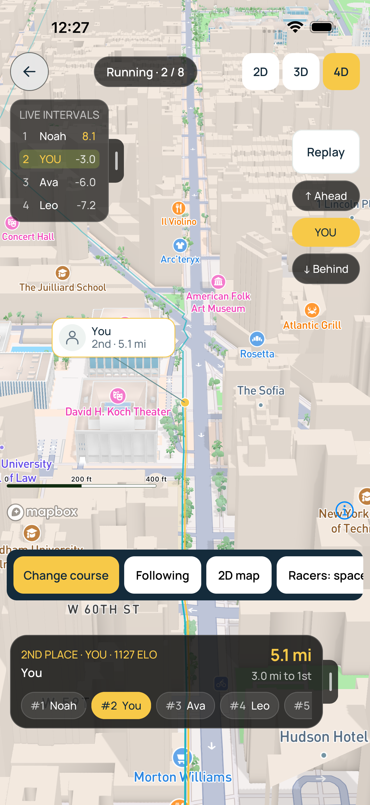
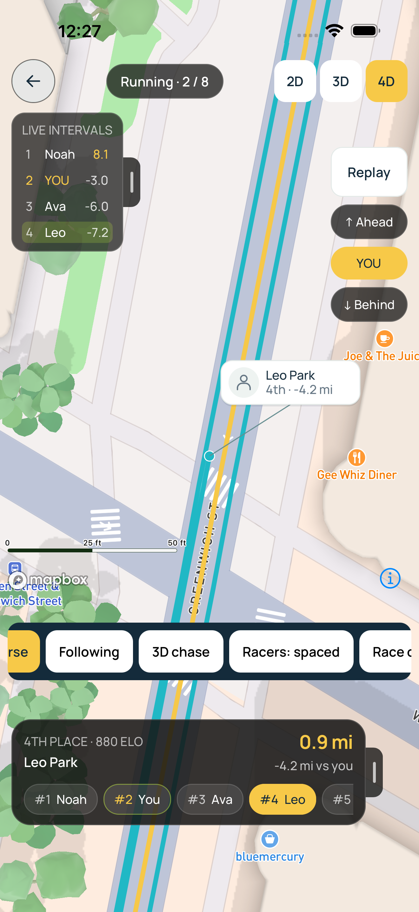

# Geographic racer cards and wider trails

This follow-up stacks on the shared 4D overlay/replay integration in #393.

The 2D athlete pennant graphic is extracted into a reusable component on each
platform and used by both the original field and geographic maps. It retains
the portrait/fallback icon, name, place, distance and leader line. Every real racer gets a card in 4D, independently of selection; 2D retains its
existing your/selected-card visibility. Stable alternating sides and vertical
tiers spread tied or nearby racers without camera-frame work. Cards stay 146 × 46 screen
points/pixels, while their leader endpoints follow the same geographic lane
coordinate as the dot and trail. Selecting another racer does not rearrange lanes.

Native Mapbox view annotations and web viewport-aligned DOM markers position the
cards above scenery. The map engine handles camera projection; React does not
reproject on each camera frame. Cards support selection, leave pan/pinch available,
and hide with the shared fullscreen overlays. Web markers explicitly position
absolutely within the map container, including during development stylesheet
refreshes. Keyboard/screen-reader targets remain available. Switching flat/chase
view during a follow flight keeps its destination on the selected racer.

Lane spacing increases by 20%, from 35 to 42 cm. Each trail grows from 12 to
36 cm, leaving a 6 cm gap at close zoom. Ten lane centers span 3.78 m; including
stroke width, the footprint is approximately 4.14 m. The minimum visible stroke
increases from 0.75 to 1.25 pixels at wide zoom. Road widths are still approximate;
the map does not infer measured road edges, and distant lanes can overlap.

The same map renderer supplies these changes in live fields and competition
replay. Routes ahead remain hidden, and replay trails use replay effort.

Runtime checks before the owner requested no further checks:
- iOS simulator: three XCTest walkthroughs passed, including overlays, gestures,
  replay and a 146 × 46 card before/after pinch zoom. Two further cases passed
  with the final trail visibility floor, including a drag starting on the card.
- Browser: real Manhattan scenery, accessible card selection, unchanged card
  dimensions through zoom, and dragging from a card suspending follow.
- Focused geometry, map-adapter and 2D interaction regressions passed. Workspace
  typechecks and the UI contract passed before the final browser layout adjustment.
  No further checks were run after the owner requested the PR be pushed.

No new native dependency or native rebuild is introduced by this follow-up.

Mapbox references: [native view annotations](https://docs.mapbox.com/ios/maps/guides/markers-and-annotations/view-annotations/)
and [web marker alignment](https://docs.mapbox.com/mapbox-gl-js/api/markers/).

## Scheduled follow-up: show all 4D racer cards

4D now supplies cards for the entire real roster, including zero-effort racers.
Past-self ghosts remain excluded. Stable ID-based screen-space tiers alternate
left/right and above/below the dot, with 54 px between rows so tied racers have
separate 46 px cards. Selecting a racer never reassigns these slots. The native
and web annotation anchors preserve the line endpoint as the card layout changes.
This uses individual cards rather than a count-only cluster. Dense courses can
still have crossing leaders or overlap when different positions project close
together; automatic screen-space clustering is not introduced. Shared fullscreen
hide controls still hide the cards, and offscreen racers do not get invented
onscreen positions. Live and competition replay use the same behavior.

No tests, typechecks, builds or UI walkthroughs were run for this scheduled
follow-up, honoring the owner's request to push without further verification.
