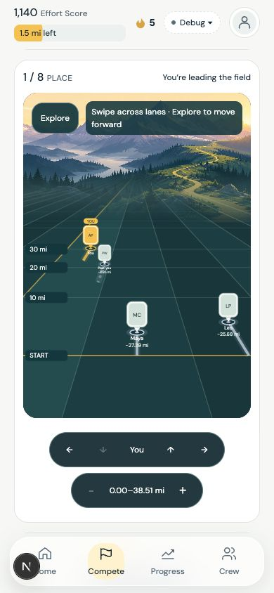
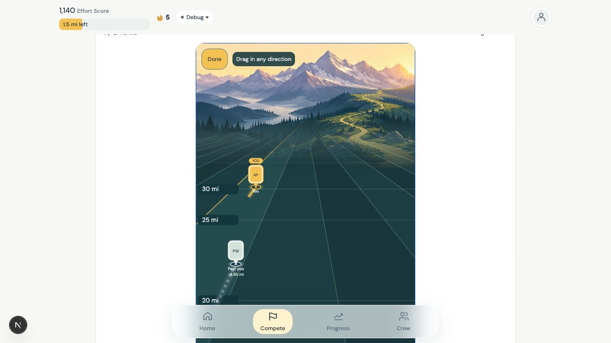
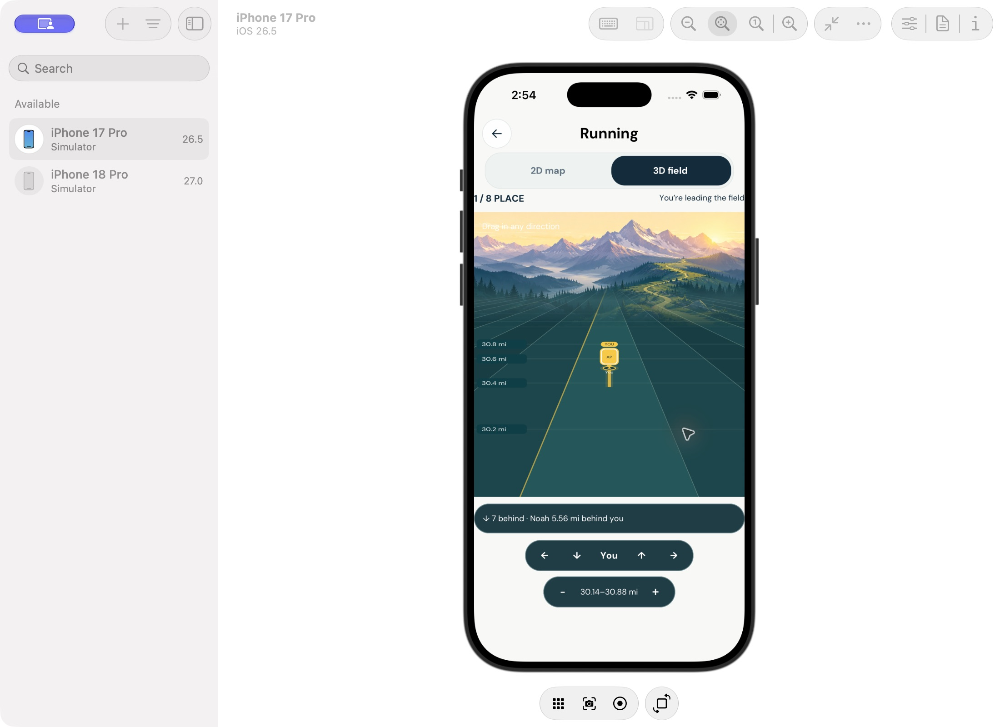

# Infinite field horizon follow-up

Follow-up to PR #348. The distance-plane revision stopped its lane geometry at
the measured window, making the scene read as a finite board. This restores the
infinite perspective on web and native while preserving actual distance spacing.

## Implementation

- The camera has a visible vanishing point at (210, 148). Ribbons converge there
  and extend beyond the foreground; the roster and current ruler do not define
  the scenery boundaries. Geometry remains a constant band of nearby lanes.
- A fixed set of increasingly distant survey lines approaches the horizon.
  A shared SVG atmosphere mask blends it into the existing alpine image. Native
  scenery covers the whole blend to avoid an image seam.
- Portrait anchors and survey ticks share the same perspective projection and
  invertible pan mapping. Small distant portrait pins remain readable.
- Native responders attach to the SVG itself so the SVG background participates
  in hit testing, with movement capture ahead of portrait targets/event paging.
  The fullscreen Modal has its own safe-area provider; its header no longer
  collides with the Dynamic Island.

There are no new dependencies, scoring rules, SQL changes, or backend writes.
The generated iOS project and build products are local/ignored, not PR contents.

## Validation

- Native rebuild: generated the iOS project, installed Pods, and successfully
  built a matching React Native 0.88.0 app with Xcode 27.1 for iPhone 17 Pro /
  iOS 26.5. Installed and launched it in the simulator. This resolves the prior
  0.86.3 binary/0.88.0 JavaScript mismatch and Worklets startup failure.
- Native UI: selected 3D, expanded fullscreen, changed distance with the controls,
  navigated to Noah at the real 24.95 mi position, and returned to you. Inspected
  the horizon and corrected the Modal safe area. The unsigned debug simulator
  emitted an unrelated expo-notifications keychain entitlement warning.
- Native limitation: Device Hub drag/scroll automation did not produce a
  verifiable field pan, so no native end-to-end drag or FPS claim is made.
  Focused renderer coverage exercises fullscreen drag capture, longitudinal
  output, lateral marker movement and one-frame event coalescing.
- Web: reviewed desktop and 390×844 layouts, wide/narrow zoom, lane navigation and
  a diagonal drag. The distance window moved from 24.58–36.43 mi to
  19.72–31.57 mi while lateral focus changed, retaining the horizon. Final browser
  error/warning logs were empty.
- Focused checks: 6 shared projection/horizon tests, 2 native portrait tests,
  4 native arena interaction tests, and 1 web portrait test pass (13 total).
  No type checks or broad test suite were run.

