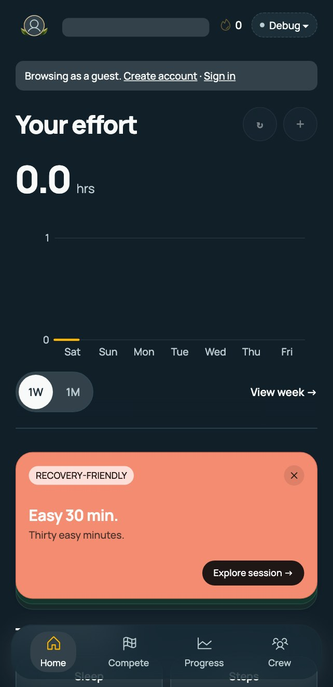
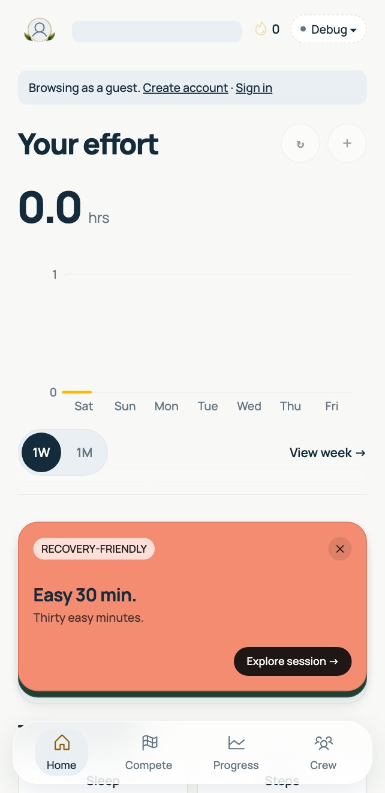
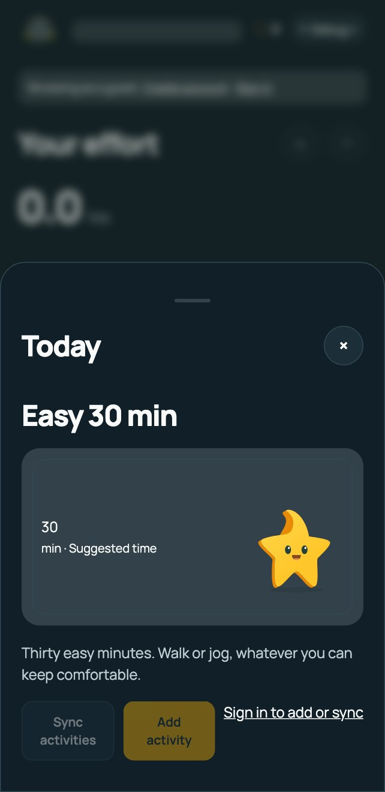
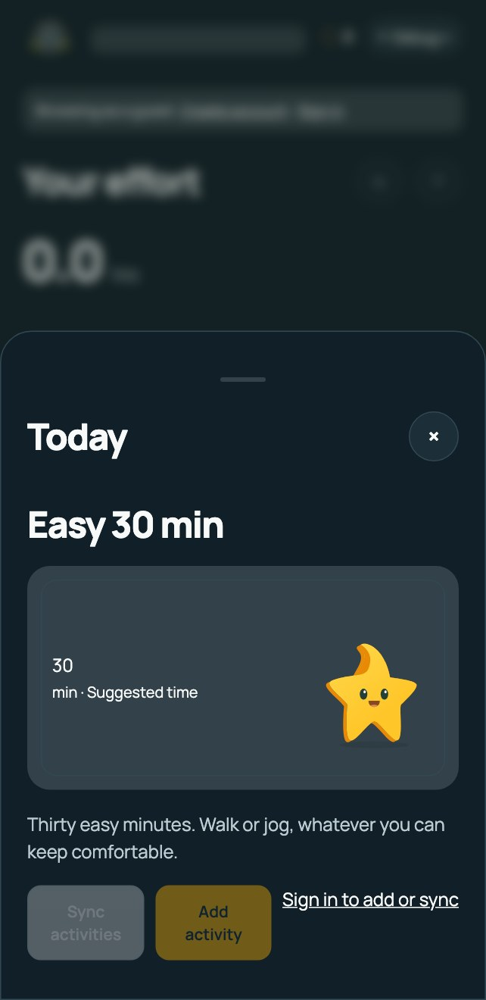
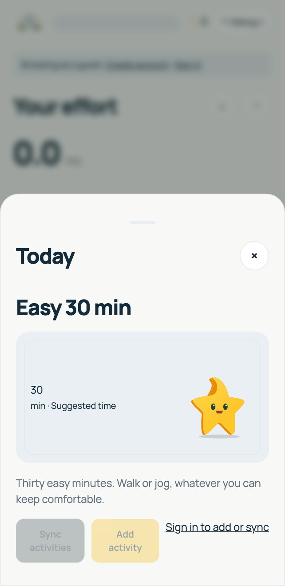
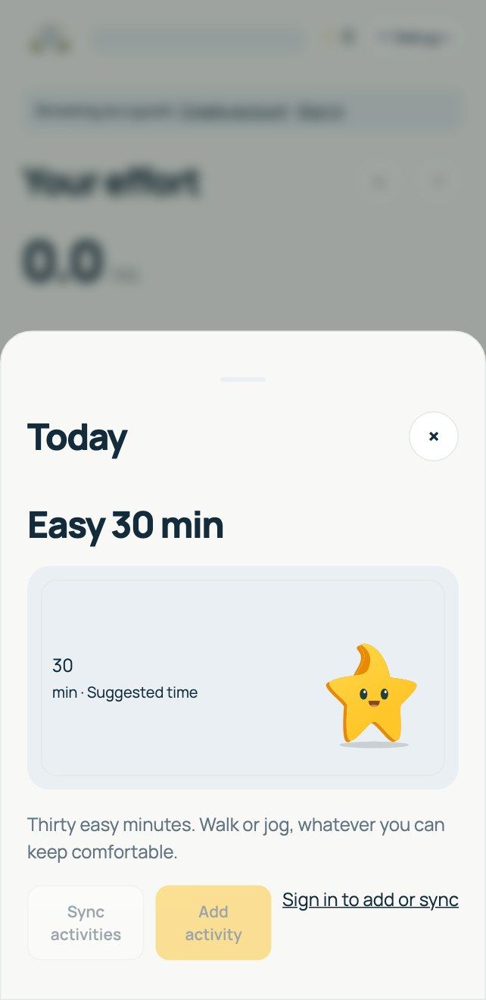

# Medal Gold preview

These are mobile-width screenshots of the web app using its guest state. The before images restore the old gold roles on the same screen. The Workout preview is Overtaek's Today session sheet, reached through Explore session. The guest account shows disabled activity controls.

| Screen | Before | After |
| --- | --- | --- |
| Home, dark |  |  |
| Home, light |  |  |
| Workout session, dark |  |  |
| Workout session, light |  |  |

The screenshots show the sRGB fallback. Headless Chromium verified the computed CSS color separately with sRGB and P3 gamut emulation. Physical-display validation requires a P3 device.

[Secondary and surface color audit](secondary-colors.md)
