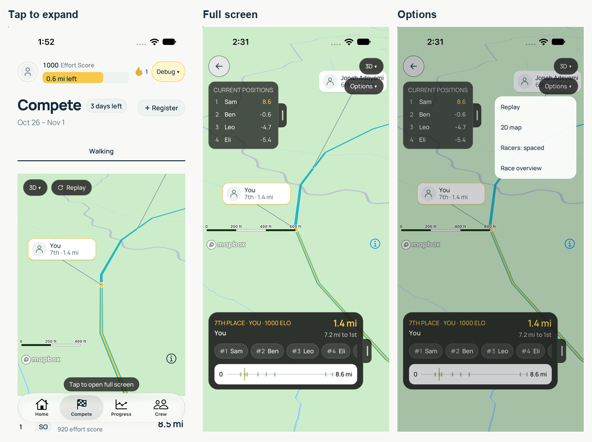

# Mobile Compete controls review

Captured October 29, 2026 on iPhone 18 Pro / iOS 27.0 in Device Hub, using the
installed native Mapbox development build and this branch's local Metro bundle.

- [Inline preview](preview.png): tap-to-expand hint; no fullscreen icon or toolbar.
- [Full screen](fullscreen.png): Options beneath the dimension selector; no bottom toolbar.
- [Open menu](options.png): Replay, 2D map / 3D chase, racer spacing, and Race overview only.

The screenshots use the existing isolated Walking debug fixture. For capture,
the automatic fixture reset after acknowledging the debug replay was temporarily
disabled locally, then restored before committing. No account data or scoring
rules were changed.

Device checks: tapping the preview opens the full-screen field; Options opens an
anchored dropdown; choosing 2D map closes it and changes the map pose. Replay opens from Options
and returns to the full-screen field. On iOS, replay presentation waits for the
menu dismissal to finish. Camera
refocusing, racer spacing, overview, and removed controls are covered by the
existing mobile interaction tests.

Validation: `pnpm typecheck`, `pnpm lint:ui`, and 21 tests across course-map,
competition-field, arena-interactions, competition-replay, and anchored-menu passed. Native
pinch remains enabled in Mapbox; this desktop simulator pass did not physically
verify a two-finger gesture. No web source or browser zoom behavior changed.
