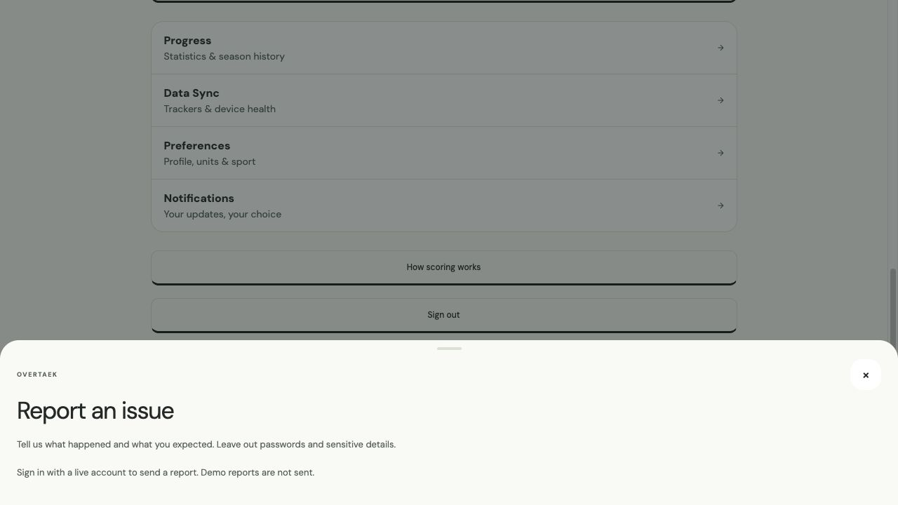

# Mobile UX parity audit — latest 50 merged PRs

Snapshot: October 18, 2026, `origin/main` at `10ddcf6` (includes #153 and #152). Sorted by merge timestamp, including stacked merges whose base was not main; #138 landed the earlier UX stack. This is a source/behavior audit, not proof that a released app binary includes these changes.

Only production behavior is promoted. Design studios, documentation proposals, browser layout/access-gating, and server/shared-engine changes do not each require a duplicate native screen. The table records these distinctions instead of treating file counts as parity.

## PR-by-PR disposition

| PR                                                                                                                                                                   | Disposition                      | Evidence / implementation                                                                                                                                                                                              |
| -------------------------------------------------------------------------------------------------------------------------------------------------------------------- | -------------------------------- | ---------------------------------------------------------------------------------------------------------------------------------------------------------------------------------------------------------------------- |
| [#152](https://github.com/jerryliu3/fitness-battle/pull/152) — feat(focus): journey history up to 30, rival matching fix, crew management polish, and leave crew RPC | Implemented                      | 30 active-day journey, truncated Past marker; Add Crew sheet, hero settings and confirmed leave call the existing RPC-backed endpoint. Rival matching is shared.                                                       |
| [#153](https://github.com/jerryliu3/fitness-battle/pull/153) — Lock Shared Start as the web and mobile app icon                                                      | Already shared                   | Shared Start launcher assets/config already cover iOS, Android and web. New native binary required.                                                                                                                    |
| [#151](https://github.com/jerryliu3/fitness-battle/pull/151) — feat(ui): apply UI polish, guest baseline 500, crew toggle, and account deletion                      | Implemented                      | Shared 30-day effort model and 500 guest baseline; crew registration toggle/explicit crew selection; disabled 3D; event preference switches; confirmed account deletion.                                               |
| [#150](https://github.com/jerryliu3/fitness-battle/pull/150) — Consolidate crew and solo week fields                                                                 | Shared backend                   | Mobile uses the existing /api/compete and /api/crews/field contracts backed by consolidated week_fields; no alternate write path.                                                                                      |
| [#149](https://github.com/jerryliu3/fitness-battle/pull/149) — Explore three longer Afterimage wakes with a shared trail endpoint                                    | Study only                       | Gated identity exploration; no production mobile feature to port.                                                                                                                                                      |
| [#148](https://github.com/jerryliu3/fitness-battle/pull/148) — Add finalized rich gold/silver app icons across web and mobile                                        | Already shared                   | Native icon assets already shipped; superseded by #153.                                                                                                                                                                |
| [#147](https://github.com/jerryliu3/fitness-battle/pull/147) — Document Afterimage identity selection and lane motion exploration                                    | Study only                       | Isolated identity/lane study with fixtures; production icons later promoted by #148/#153.                                                                                                                              |
| [#146](https://github.com/jerryliu3/fitness-battle/pull/146) — Fix account names, in-app issue reporting, and journey layouts                                        | Implemented                      | Native issue-report dialog via existing authenticated Resend endpoint; shared account-name fallback; native journey spacing and crew control removal retained.                                                         |
| [#145](https://github.com/jerryliu3/fitness-battle/pull/145) — feat(compete): unify solo and crew week fields for real multiplayer standings                         | Implemented + shared             | Native registration seats an explicitly selected eligible crew through /api/crews/field. Open fields hydrate via shared account API.                                                                                   |
| [#143](https://github.com/jerryliu3/fitness-battle/pull/143) — fix(auth,seed): fix post-login redirect and populate rich seed data                                   | Implemented / browser-specific   | Synthetic account fixtures moved to shared code and available to mobile demo accounts. Browser hard navigation is Next-specific.                                                                                       |
| [#141](https://github.com/jerryliu3/fitness-battle/pull/141) — feat(arena): play overtake animation on lane track with rival reconciliation                          | Already shared                   | Both lane renderers use shared overtake reconciliation, account/sport/track baselines and reduced motion.                                                                                                              |
| [#142](https://github.com/jerryliu3/fitness-battle/pull/142) — fix(today): Ember clipping and journey empty space                                                    | Platform-specific                | Browser overflow/flex fix was in a stacked PR. Native journey now has explicit top clearance and fixed rows inside its single ScrollView.                                                                              |
| [#140](https://github.com/jerryliu3/fitness-battle/pull/140) — feat(ui): journey layout, competition card, sport-to-event copy, and solo crew preview                | Implemented                      | Native Competition card, signed-out solo-circle crew preview, generic event copy, opaque past stop and journey labels.                                                                                                 |
| [#139](https://github.com/jerryliu3/fitness-battle/pull/139) — feat(ui): implement Open Field styling and home cumulative hours line chart                           | Already present + aligned        | Both apps have cumulative-hour charts and Open Field tokens. Native shared cards/buttons receive the tactile border/radius treatment.                                                                                  |
| [#136](https://github.com/jerryliu3/fitness-battle/pull/136) — feat(design): add overtake motion playground and refine staggered double-exposure race                | Study only                       | Motion playground is a gated review surface; production overtake behavior came through #141.                                                                                                                           |
| [#138](https://github.com/jerryliu3/fitness-battle/pull/138) — Land #131 + #132 on main (journey polish + guest effort 0)                                            | Implemented + shared             | Landing merge of #131/#132. Shared baselines; native journey/profile parity addressed here. Native notifications remain device-native.                                                                                 |
| [#137](https://github.com/jerryliu3/fitness-battle/pull/137) — feat(timezone): adopt America/New_York (EST/EDT) as source of truth for periods and standings         | Implemented + shared             | Native journey now uses shared APP_TIMEZONE calendar grouping. Core period/matching logic is shared; no new period/scoring rule is introduced.                                                                         |
| [#133](https://github.com/jerryliu3/fitness-battle/pull/133) — Add brand and Ember studio with neutral skin concepts                                                 | Study only                       | Brand/locker prototypes explicitly do not establish production rewards or account entitlements.                                                                                                                        |
| [#132](https://github.com/jerryliu3/fitness-battle/pull/132) — fix: guest effort 0, crew note dupe, Overtaek mailto (stacked on #131)                                | Implemented + shared             | Guest score comes from shared engine (latest baseline 500); duplicate crew errors removed; mailto superseded by in-app reporting.                                                                                      |
| [#131](https://github.com/jerryliu3/fitness-battle/pull/131) — fix(ui): polish journey, registration, profile, and guest labels                                      | Implemented                      | Shared day-grouping/lane planning/center-derived path; native photo upload/removal; current registration and effort labels.                                                                                            |
| [#130](https://github.com/jerryliu3/fitness-battle/pull/130) — feat: rebrand remaining user-facing Elo references to effort score                                    | Already present                  | Effort-score wording exists in native Athlete, Progress, benchmarks and crew copy.                                                                                                                                     |
| [#129](https://github.com/jerryliu3/fitness-battle/pull/129) — Keep the open week when stopping and refresh real crew scores                                         | Implemented + shared             | Native open-week save errors now visible and retryable; account saves serialized/scoped; current-week stop/keep and refresh use existing shared rules.                                                                 |
| [#127](https://github.com/jerryliu3/fitness-battle/pull/127) — feat(ux): journey polish, elo chart redesign, 2d lane start anchor, and profile photos                | Implemented                      | Shared effort chart, native photo picker/upload, Data Sync label, center-derived journey and start-anchor viewport.                                                                                                    |
| [#125](https://github.com/jerryliu3/fitness-battle/pull/125) — fix(ux): address signed-out review findings and road race rankings                                    | Implemented / platform-specific  | Crew targets/feed/standings honor units. Benchmark tier disclosed. Native file picker uses existing import endpoint. Web shell/rankings/404 specifics are browser-specific; native has branded fallback.               |
| [#126](https://github.com/jerryliu3/fitness-battle/pull/126) — feat: rebrand Elo to effort score across user-facing copy and components                              | Already present                  | Shared effort-score naming, later completed by #130.                                                                                                                                                                   |
| [#124](https://github.com/jerryliu3/fitness-battle/pull/124) — Restrict /design and /ux routes to 3jerryliu@gmail.com in production                                  | Browser-specific                 | Production access gate for browser design/UX routes; does not introduce a native product screen.                                                                                                                       |
| [#123](https://github.com/jerryliu3/fitness-battle/pull/123) — feat(ui): 27-point UX overhaul for Today, Arena, and Athlete                                          | Implemented                      | Native journey, effort trend, profile editing, onboarding, countdown, sleep registration, standings segment, zoom slider, inline athlete detail and first-place Ember. Native event chips retain per-event navigation. |
| [#122](https://github.com/jerryliu3/fitness-battle/pull/122) — docs: define weekly congratulations and mutual rematch preferences                                    | Proposal only                    | Weekly congratulations/rematch preferences are documentation proposals; no web production feature to mirror.                                                                                                           |
| [#121](https://github.com/jerryliu3/fitness-battle/pull/121) — docs: refine selected fitness UI directions and add interactive review                                | Proposal only                    | Material/motion candidates and review artifact; no production behavior.                                                                                                                                                |
| [#120](https://github.com/jerryliu3/fitness-battle/pull/120) — fix(web): resolve signed-out UX bugs, modal layering, and guest states                                | Implemented / platform-specific  | Native guest auth gates retained; freeze confirm/undo plus status; clear sync feedback; branded not-found. Browser dialog portals remain Radix-specific.                                                               |
| [#118](https://github.com/jerryliu3/fitness-battle/pull/118) — Fix blank single-value Elo chart on Athlete                                                           | Implemented                      | Shared effort-history presentation includes a visible current point with a single value and a full axis.                                                                                                               |
| [#119](https://github.com/jerryliu3/fitness-battle/pull/119) — Compete tab rename + Strava-style Athlete settings                                                    | Already present                  | Compete tab label and profile-first Athlete settings navigation already exist on mobile.                                                                                                                               |
| [#117](https://github.com/jerryliu3/fitness-battle/pull/117) — UX polish: Home, Arena, Athlete, shell (web + mobile)                                                 | Implemented / already present    | Native suggestion expands in-place; units and sport-specific joins; account email, coming-soon 1v1, and settings list retained. Crew preview/journey omissions closed.                                                 |
| [#110](https://github.com/jerryliu3/fitness-battle/pull/110) — Interface concepts only: standalone web and native gallery                                            | Study only                       | Interface concept gallery; production implementation came via #113 and subsequent UX PRs.                                                                                                                              |
| [#109](https://github.com/jerryliu3/fitness-battle/pull/109) — fix(compete): migration resilience + stack review hardening                                           | Shared backend                   | Migration resilience/request-auth hardening affects the server called by native bearer-authenticated requests.                                                                                                         |
| [#108](https://github.com/jerryliu3/fitness-battle/pull/108) — fix(api): use request-scoped Supabase client for compete                                              | Shared backend                   | Request-scoped Supabase clients preserve RLS identity for native bearer tokens.                                                                                                                                        |
| [#107](https://github.com/jerryliu3/fitness-battle/pull/107) — chore(ci): add typecheck/test workflow and living coding docs                                         | Infrastructure                   | CI workflows and coding standards; not a separate native UX feature.                                                                                                                                                   |
| [#106](https://github.com/jerryliu3/fitness-battle/pull/106) — fix(security): guard oauth state secret in production and add rate limiting to push send              | Shared backend                   | OAuth-secret and push-send hardening live on shared server APIs.                                                                                                                                                       |
| [#105](https://github.com/jerryliu3/fitness-battle/pull/105) — fix(web): lazy tab mounting in phone shell, safe local storage, and seeded state effect               | Browser-specific                 | Lazy PhoneShell tabs and localStorage safety. Mobile account cache/saves now independently hardened.                                                                                                                   |
| [#104](https://github.com/jerryliu3/fitness-battle/pull/104) — fix(compete): guard settlement place bounds, sport-specific pace base, and non-gps dedupe             | Shared domain                    | Settlement bounds, sport-specific pace and deduplication ship in shared engine/tests.                                                                                                                                  |
| [#115](https://github.com/jerryliu3/fitness-battle/pull/115) — Expo web Arena 3D in-process; native WebView only                                                     | Already present; rollout changed | Native WebView and Expo-web pursuit renderer remain in source; the production 3D control is now disabled per #151.                                                                                                     |
| [#114](https://github.com/jerryliu3/fitness-battle/pull/114) — Focus cleanup stack: drop 1v1, strip study bloat, Arena/Home fixes                                    | Already shared                   | No-live-1v1 policy and ghost/period/selection helpers are shared; native teaser stays disabled.                                                                                                                        |
| [#113](https://github.com/jerryliu3/fitness-battle/pull/113) — Focus production revamp (Trail Crew/Athlete + vertical Arena lanes)                                   | Implemented / already present    | Focus tabs, lane viewport, crew activity/member composition, Athlete metrics. Newer web refinements ported by this PR.                                                                                                 |
| [#103](https://github.com/jerryliu3/fitness-battle/pull/103) — Promote Ember skid loading animation and shared mascot model to web and mobile                        | Already shared                   | Boot/mascot geometry and timing have native and web renderers using shared model.                                                                                                                                      |
| [#99](https://github.com/jerryliu3/fitness-battle/pull/99) — Prototype crest-first Ember takeoff and hard-skid landing                                               | Study / shared motion            | Prototype animation and shared mascot studies; selected production motion follows #103.                                                                                                                                |
| [#95](https://github.com/jerryliu3/fitness-battle/pull/95) — Give Ember a reversible K morph and responsive product motion                                           | Already shared                   | Reversible K/Ember model and native motion renderer retained. New journey does not replace the shared mascot model.                                                                                                    |
| [#94](https://github.com/jerryliu3/fitness-battle/pull/94) — Add 2D lanes and 3D Pursuit to the mobile arena                                                         | Native-specific                  | Original native 2D/3D implementation; viewport preserved, 3D intentionally gated by latest product direction.                                                                                                          |
| [#100](https://github.com/jerryliu3/fitness-battle/pull/100) — Seed local test accounts                                                                              | Implemented + backend fixtures   | Server seed accounts remain shared; explicitly synthetic device demo fixtures are now shared with web.                                                                                                                 |
| [#93](https://github.com/jerryliu3/fitness-battle/pull/93) — Mobile You: clear account auth + Apple Health sync fixes                                                | Native-specific / retained       | Native account clarity and Apple Health/Health Connect permission/live-vs-demo behavior retained; new controls reuse these paths.                                                                                      |
| [#92](https://github.com/jerryliu3/fitness-battle/pull/92) — Boot splash: fly behind letters, around O, crossfade to K                                               | Already shared                   | Boot splash uses shared motion; no browser-only feature requiring duplication.                                                                                                                                         |

## Native implementation map

- `apps/mobile/src/features/journey.tsx` uses shared day grouping, lane assignment and paths from circle centers, with 30 active days, full per-day session details, opaque placeholders and Past overflow marker.
- `apps/mobile/src/features/effort-trend.tsx` and web Athlete consume `packages/shared/src/effort-history.ts`, preserving both tracks, the full date axis, baseline and leading gap.
- `apps/mobile/src/features/profile-photo.tsx` uses the system picker and existing avatars bucket/RLS. Live uploads remain server-backed; demo photos stay local.
- Native Compete adds Competition dates/countdown, crew registration selection via the existing field endpoint, Sleep & Recovery, zoom/standings, inline athlete detail and disabled 3D. Native event chips keep per-event navigation rather than rendering several 540px lane tracks at once.
- Crew uses real membership/data for live accounts; a one-person circle previews the full layout for guests/new athletes. Add/Join, invite, rest and leave use existing endpoints. All distances use athlete units.
- Native Data Sync adds cloud sync/disconnect, Garmin import and pending review, honest sample-sleep/calibration controls. Native health permissions remain device-specific.
- Athlete adds onboarding access, freeze confirmation/undo, issue reporting, confirmed account deletion, save failure/retry and account-name repair.
- Native training, dirty drafts, seen activity and lane baselines are scoped to the current account. Old unscoped caches are not automatically uploaded into a newly signed-in account. An explicit review/RESTORE flow preserves both documents as backups before assigning older device history.

## Verification and review

See the PR description for exact final check results and the post-implementation review findings/fixes. Native photo/document picker additions require a new development/production binary. Live email delivery needs Resend server credentials; actual provider OAuth, device health prompts and destructive live account/crew operations are not exercised against a real user during verification.

## Deep review follow-up

The implementation was reviewed again after PR creation. Findings fixed in the follow-up commit:

1. Native `AbortSignal.timeout` is absent in React Native's bundled abort-controller. All new native API requests now use a timed AbortController; regression tests exercise a runtime with no static AbortSignal method.
2. A failed initial account load must not permit a fresh device document to replace the server account. Editing/saving is blocked until a successful reload; cached drafts are retained and Retry reloads the account.
3. Account switches and unmounts can race photo pickers, crew seating, syncs, refreshes and deletion. Operations are bound to the requesting account, stale actions are rejected, and local deletion accepts an explicit expected owner.
4. Re-showing BootSplash while an account reloads unmounted the navigator and reset the current route. The navigator now stays mounted after initial launch; an eight-second deadline releases stalled splash animation while still waiting for initial data.
5. Supabase Auth deletion can fail while the user owns avatar objects. The server removes only that authenticated user's avatar folder first, handles storage failures honestly, and rejects missing deletion configuration instead of pretending success.
6. Native photo removal now removes the stored canonical/legacy avatar objects rather than merely hiding their public URL. Picker permission configuration is explicit and does not request camera/microphone access.
7. Crew feeds refresh while focused; failed post-write refreshes stay visible. Cooperative progress and all distance labels retain their own units/format semantics. Tied native standings count only athletes strictly ahead.
8. Calendar-day history uses Eastern date boundaries across midnight/DST; settled score changes appear at the closed-week boundary. Previous-week charts obtain actual period bounds instead of subtracting a fixed 168 hours. Journey lane assignment uses full history before applying its visible cap, keeping older stops stable.
9. Activity-age badges now use actual counted timestamps on both platforms. Unknown rivals display an unavailable marker; the older web hash-generated “minutes ago” values are no longer manufactured.
10. Remaining obsolete native Home/profile headings were removed; the Data Sync menu label, scoring explainer and conditional awards match the current product. Duplicate week-complete prompts were removed. Dead path/chart code and imports were removed after the shared-model extraction.

Regression coverage includes real provider mount/update cycles for guest→Alice→Bob→guest, rapid sequential edits, open-week conflict/retry, stale refreshes, stale attributed actions, exact account-cache cleanup and failed initial loads. These are mocked native lifecycle tests, not destructive tests against real user data.

## Final validation

- Workspace `pnpm typecheck`: passed; final native edits also checked with the mobile TypeScript task.
- `pnpm test`: 468 passed, 4 existing database seed integration tests skipped. Native lifecycle/transport regressions were rerun after the final cleanup guards.
- Production Next.js web build: passed.
- Expo iOS **and** Android Hermes exports: passed.
- Expo-web smoke: Home/day history, guest Crew composition, demo sign-in hydration, Competition/standings/sleep, Open/GPS history, scoring explanation and the issue dialog. Actual native device permission prompts and live destructive operations were not exercised.

