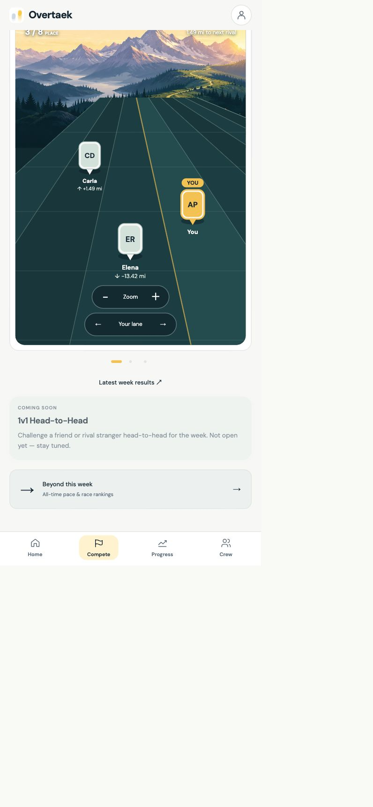
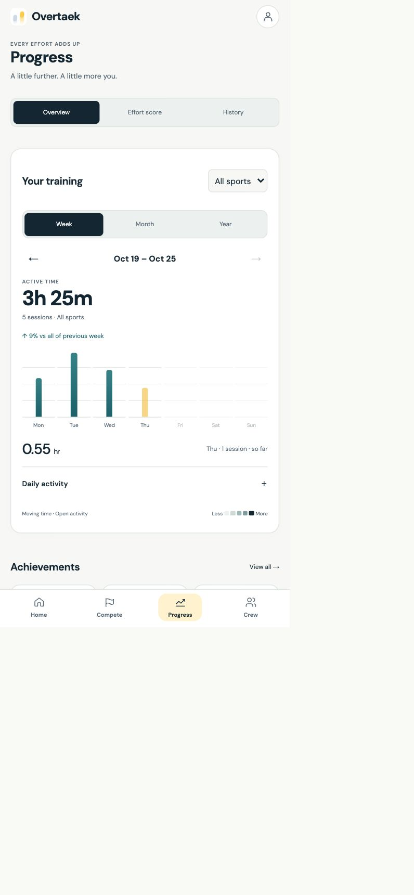

# Portrait competition field follow-up

Stacked on Everyday Club PR #273. The 2D map remains the default; selecting **3D field** opens a separate fixed-camera SVG perspective renderer shared by web and native. The previous Three.js implementation and native WebView bridge remain in code for future combinations.

## Changes

- Converging teal lanes over the existing alpine illustration. Profile photos appear in small portrait pins; missing photos use real initials. Yellow identifies You. Drag panning is disabled; explicit lane arrows reach every peer and Your lane restores the horizontal camera anchor. Portrait selection uses the existing athlete-selection path.
- Both boards overlay place, distance to the next higher-total rival and zoom. Out-of-window athletes retain their true relative gaps and directional arrows. These are accumulated competition totals, not live positions or GPS scenery.
- Unfolded 2D lane spacing is exactly three times its previous width at the same viewport/zoom. Racer and longitudinal distance scales are unchanged. The existing oval remains its separate circuit geometry.
- Crew reserves unfilled runway beyond both the recorded total and finish, with a high-contrast checkered stripe that members can cross. Cooperative crews now use their already-configured journey distance, personal-target crews use their existing session targets, and volume crews use last week's actual baseline. Missing baseline data never invents a finish.
- Progress bars are slender teal columns with quiet gridlines, large active-time totals and actual previous-week/month/year deltas. Partial periods explicitly compare with all of the previous period; zero history does not produce an infinite or fabricated percentage.

## Verification

- `pnpm typecheck`: all workspaces pass.
- `pnpm test`: 694 pass, five existing skips. New coverage includes locked projection/ranking, true out-of-range gaps, stable lane identity, unchanged racer scale, native zoom/peer controls, actual portrait rendering, below/at/over-goal Crew runway, configured cooperative targets, and honest timeframe deltas.
- Production web build: passes, 71 static pages.
- iOS native build: succeeds with zero compiler errors/warnings, installs and launches on iPhone 17 Pro / iOS 26.5. Final iOS Hermes export passes.
- Browser: exercised 3D selection, zoom, peer navigation and prior-week Progress. Native 2D overlay was visually inspected after launch; Device Hub subsequently failed to dispatch native taps (`noWindowsAvailable`), so the native portrait controls are covered by renderer interaction tests rather than a completed simulator tap-through.
- Existing heavy mascot tests timed out during one concurrent bundling run; after stopping orphaned workers from the failed run, the full unmodified suite passes.

No scoring, enrollment, tracker, database or backend write paths change. No deployment or merge was performed.

